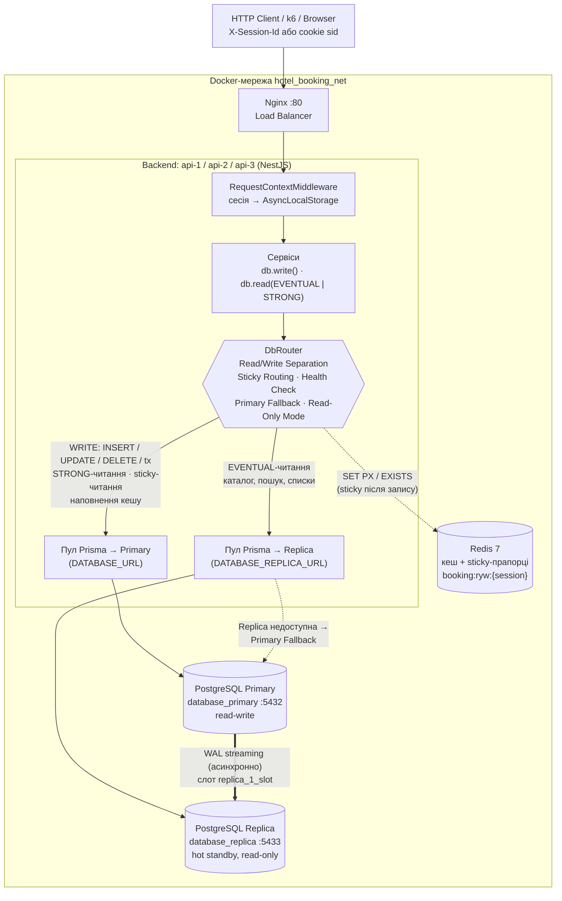
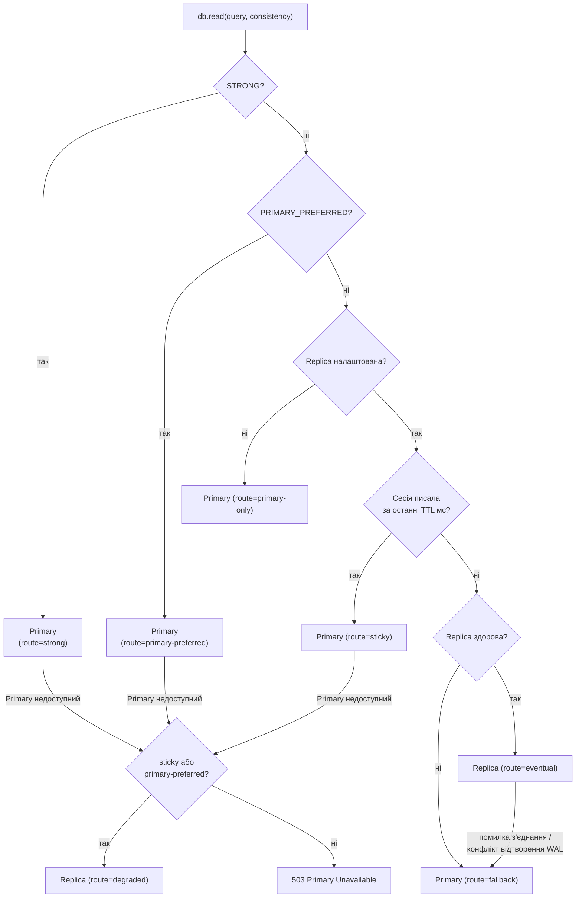

# Лабораторна робота № 6

**Тема:** Реплікація баз даних (Database Replication) та розділення потоків читання і запису (Read/Write Separation)
**Проєкт:** Booking_Hotel — NestJS API (3 інстанси) + Nginx + PostgreSQL 16 Primary / Read Replica + Redis 7

---

## 1. Завдання і що зроблено

| Пункт | Вимога | Як реалізовано | Файли |
|---|---|---|---|
| 2.1 | Топологія Primary / Replica, демонстрація автореплікації | Фізична streaming replication PostgreSQL 16: Primary (`database_primary`) стрімить WAL на hot standby (`database_replica`). Replica створюється через `pg_basebackup -R` зі слотом реплікації | `docker-compose.yml`, `docker/postgres/primary/01-replication.sh`, `docker/postgres/replica/entrypoint.sh` |
| 2.2 | Read/Write Separation | Програмна маршрутизація на рівні Data Access Layer: два пули з'єднань Prisma (Multi-Pool Manager) і маршрутизатор `DbRouter` | `src/database/db-router.service.ts`, `src/database/replica-prisma.service.ts` |
| 2.3 | Класифікація читань, Replication Lag, Stale Read | Кожне читання позначене `EVENTUAL` / `STRONG` / `PRIMARY_PREFERRED`; lag вимірюється через `pg_stat_replication` і LSN; синтетичний lag — `recovery_min_apply_delay` | `src/*/**.service.ts`, `src/database/replication.service.ts`, `scripts/replication-demo.js` |
| 2.4 | Read-After-Write Consistency | **Session Sticky Routing** (сесія після запису читає з Primary протягом TTL, спільно для всіх інстансів через Redis) + **Explicit Primary Routing** для критичних об'єктів | `src/database/db-router.service.ts`, `src/database/request-context.ts` |
| 2.5 | Відмова Replica / Primary | Health checking вузлів + класифікація помилок з'єднання: без Replica → Primary Fallback; без Primary → Read-Only Mode (503 на запис, читання каталогу з Replica) | `src/database/db-router.service.ts`, `src/health/health.controller.ts` |
| 2.6 | Single Primary vs Primary + Replica | Експеримент `replication` у скриптах Лаб. №5 (k6): нові сценарій D (mixed) і compose-override для Single Primary | `load-tests/run-load-tests.ps1`, `load-tests/scenario-d-mixed.js`, `load-tests/docker-compose.single-db.yml`, `load-tests/report.js` |
| 3 | Конфігурації, код, звіт, архітектурна схема | Цей файл, розділ README, діаграми нижче | `docs/LAB6.md`, `README.md` |

---

## 2. Архітектура: топологія СУБД і потоки R/W трафіку



**Як `DbRouter` обирає вузол для читання:**



Кожна відповідь API містить заголовки `X-DB-Node` (`primary` / `replica`) і `X-DB-Route` (причина вибору), тому маршрутизацію видно в будь-якому HTTP-клієнті.

---

## 3. Топологія реплікації (п. 2.1)

### 3.1. Конфігурація

| Вузол | Контейнер | Налаштування |
|---|---|---|
| Primary | `database_primary` (порт 5432) | `wal_level=replica`, `max_wal_senders=10`, `max_replication_slots=10`, `wal_keep_size=256MB`, `synchronous_standby_names=''` (асинхронна реплікація). Init-скрипт створює роль `replicator WITH REPLICATION`, фізичний слот `replica_1_slot` і рядок `host replication replicator all scram-sha-256` у `pg_hba.conf` |
| Replica | `database_replica` (порт 5433) | При першому старті `pg_basebackup -X stream -S replica_1_slot -R` копіює Primary і створює `standby.signal` + `primary_conninfo`. Далі — `hot_standby=on` (read-only запити під час відтворення WAL), `hot_standby_feedback=on` (менше конфліктів з VACUUM на Primary) |

**Чому слот реплікації.** Без нього Primary може видалити сегменти WAL, які Replica ще не отримала (наприклад, поки вона була зупинена), і Replica довелося б пересоздавати. Зі слотом Primary зберігає WAL, доки Replica його не підтвердить, тож після `docker start database_replica` вона просто наздоганяє Primary. Ціна — WAL накопичується на Primary, поки Replica лежить, тому в продакшні слоти треба моніторити (`pg_replication_slots`).

**Чому асинхронна.** `COMMIT` на Primary не чекає на Replica: запис не сповільнюється і не блокується відмовою Replica. Ціна — Replication Lag (Stale Reads) і можлива втрата останніх транзакцій, якщо Primary впаде до відправки WAL.

API отримує два рядки підключення: `DATABASE_URL` (Primary) і `DATABASE_REPLICA_URL` (Replica). Порожній `DATABASE_REPLICA_URL` = Single Primary Topology. У Kubernetes / Helm (ЛР DevOps) Replica не розгортається, тому там API автоматично працює в режимі `primary-only`.

### 3.2. Демонстрація: `npm run repl:replicate`

```text
POST /hotels                       201  node=primary  route=write

Primary (database_primary):  Replication Demo 11:12:19|Kyiv
Replica (database_replica):  Replication Demo 11:12:19|Kyiv

Позиції WAL:
  Primary  pg_current_wal_lsn()      = 0/3090418
  Replica  pg_last_wal_replay_lsn()  = 0/3090418

pg_stat_replication на Primary (client | state | sync_state | replay_lag):
  172.19.0.7/32 | streaming | async | 00:00:00.001889

Спроба запису напряму в Replica:
  ERROR:  cannot execute INSERT in a read-only transaction
```

Запис через API потрапив на Primary і за ~2 мс з'явився на Replica (LSN збігаються). Сама Replica працює лише на читання. Повний стан — `GET /replication/status` або `npm run repl:status`.

---

## 4. Read/Write Separation (п. 2.2)

Маршрутизація **програмна, на рівні Data Access Layer** (Dynamic DataSource Routing / Multi-Pool Manager):

- `PrismaService` — пул до Primary, `ReplicaPrismaService` — окремий пул до Replica.
- `DbRouter` — єдина точка прийняття рішення. Сервіси не знають адрес вузлів, вони декларують тип операції:

```ts
// мутація → завжди Primary
this.db.write((db) => db.hotel.create({ data }));

// публічний каталог → Replica (eventual)
this.db.read((db) => db.hotel.findMany());

// підтвердження бронювання → завжди Primary (strong)
this.db.read((db) => db.booking.findUnique({ where: { id } }), Consistency.STRONG);
```

Інтерактивна Serializable-транзакція бронювання повністю загорнута в `db.write(...)`, тож перевірка доступності номера і `INSERT` йдуть на Primary в одній транзакції.

Чому програмно, а не через проксі (PgBouncer / Pgpool-II): проксі не знає бізнес-контексту (що є «підтвердженням бронювання», яка сесія щойно писала) і без розбору SQL не відрізнить критичне читання від некритичного. На рівні коду класифікація явна і перевіряється юніт-тестами (`src/database/db-router.service.spec.ts`).

---

## 5. Класифікація читань і Replication Lag (п. 2.3)

### 5.1. Бізнес-операції

| Операція | Узгодженість | Вузол | Обґрунтування |
|---|---|---|---|
| `GET /hotels`, `GET /rooms`, `GET /rooms/:id` | Eventual | Replica | Публічний каталог; відставання на мілісекунди непомітне |
| `GET /rooms/search` | Eventual | Replica (кеш) | Застарілий результат безпечний: доступність остаточно перевіряється в Serializable-транзакції на Primary під час бронювання (у гіршому разі 409) |
| `GET /hotels/:id` | Eventual | Redis → Primary при MISS | Кеш наповнюється з Primary, інакше відстала Replica записала б застарілу копію на весь TTL (600 с) замість мілісекунд lag-у. Без Redis — Replica |
| `GET /guests`, `GET /bookings` | Eventual | Replica | Адміністративні списки / звітність |
| `GET /guests/:id`, `GET /guests/:id/bookings` | Eventual + **RYW** | Replica, після власного запису — Primary | Профіль і «мої бронювання»: чужі зміни можуть з'явитися із запізненням, але свої користувач має бачити одразу (Sticky Routing) |
| `GET /bookings/:id` | **Strong** | Primary | Підтвердження транзакції: клієнт відкриває його одразу після `POST /bookings`; з Replica він отримав би 404 або старий статус |
| Перевірки перед записом: існування готелю / гостя / номера, унікальність email, доступність номера | **Strong** | Primary | Рішення про запис не можна приймати за застарілими даними (гостя часто створюють за мить до бронювання) |
| `POST` / `PATCH` / `DELETE`, транзакції | Write | Primary | Replica read-only |

### 5.2. Вимірювання lag-у

- На Primary: `pg_stat_replication` → `sent_lsn`, `replay_lsn`, `write_lag` / `flush_lag` / `replay_lag` і відставання в байтах `pg_wal_lsn_diff(pg_current_wal_lsn(), replay_lsn)`.
- На Replica: `pg_last_wal_receive_lsn()` vs `pg_last_wal_replay_lsn()` (отримано, але ще не застосовано), `pg_is_wal_replay_paused()`.
- Усе це віддає `GET /replication/status`. У звичайному режимі в Docker-мережі `replay_lag` ≈ 1–2 мс, `behindBytes = 0`.

### 5.3. Синтетичний lag і Stale Read

На такому малому lag-у застаріле читання майже не відтворити, тому затримка відтворення WAL задається на Replica параметром `recovery_min_apply_delay`. Він змінюється без рестарту: `npm run repl:lag -- 3000`, `0` вимикає.

`npm run repl:stale` (lag 3000 мс, запити розподіляються Nginx між різними інстансами API):

```text
[writer] POST /guests                  201  node=primary  route=strong,write
[writer] PATCH /guests/:id phone→NEW   200  node=primary  route=strong,write   api=cc668d777e9d

Одразу після запису:
[reader] GET /guests/:id               200  node=replica  route=eventual  api=822d8b62df1a  phone=+380-OLD  ← STALE READ
[writer] GET /guests/:id               200  node=primary  route=sticky    api=1760717522fe  phone=+380-NEW  ← Sticky Routing (RYW)
[writer] GET /guests/:id/bookings      200  node=primary  route=sticky    api=cc668d777e9d
[writer] POST /bookings                201  node=primary  route=strong,write
[reader] GET /bookings/:id             200  node=primary  route=strong    ← Explicit Primary Routing

[reader] GET /guests/:id               200  node=replica  route=eventual  phone=+380-NEW

Вікно Stale Read ≈ 3130 мс (Replication Lag).
```

- Інша сесія (`reader`) одразу після запису отримала з Replica **старий телефон** — це Stale Read. Якщо читати щойно створеного гостя, буде навіть 404.
- Сесія, що писала (`writer`), отримала **нове значення** з Primary, хоча запит обробив інший інстанс API: sticky-прапорець лежить у Redis.
- Підтвердження бронювання завжди читається з Primary, навіть для чужої сесії.

---

## 6. Read-After-Write Consistency (п. 2.4)

### 6.1. Session Sticky Routing (основний механізм)

1. `RequestContextMiddleware` визначає сесію: заголовок `X-Session-Id` або cookie `sid` (якщо немає, видає новий і повертає cookie). Сесія живе в `AsyncLocalStorage`, тому доступна маршрутизатору без передачі параметрами.
2. Після успішного `db.write()` маршрутизатор ставить прапорець `booking:ryw:{session}` у Redis з `PX = RYW_STICKY_TTL_MS` (5000 мс) і в локальну пам'ять інстансу.
3. `db.read()` з `EVENTUAL` для сесії з активним прапорцем іде на Primary (`route=sticky`).

**Чому Redis.** Nginx розподіляє запити між трьома інстансами API, і наступне читання майже напевно потрапить на інший інстанс. Локальна пам'ять цього не покриває, а спільний Redis покриває. Якщо Redis недоступний, лишається локальна копія: гарантія діє в межах інстансу, що прийняв запис.

**Вибір TTL.** TTL має бути більшим за p99 Replication Lag. Нормальний lag ≈ мілісекунди, тому 5 с — запас на сплески (наприклад, VACUUM чи пакетний імпорт на Primary). Надто великий TTL зменшує частку читань на Replica: сесії, що часто пишуть, постійно «прилипають» до Primary.

### 6.2. Explicit Primary Routing

Операції, де застаріле читання неприпустиме навіть для чужої сесії, завжди йдуть на Primary (`Consistency.STRONG`): підтвердження бронювання і всі перевірки перед записом (див. 5.1).

### 6.3. Захист кешу від застарілих даних

Кеш (ЛР №4) наповнюється з Primary (`PRIMARY_PREFERRED`). Інакше після інвалідації наступний MISS прочитав би ще не оновлену Replica і зберіг би застарілі дані на весь TTL кешу. У Read-Only Mode кеш наповнюється з Replica: записів немає, і вона актуальна.

### 6.4. Альтернатива: LSN-верифікація (не реалізована)

Після запису зберігати `pg_current_wal_lsn()` у сесії, а перед читанням з Replica перевіряти `pg_last_wal_replay_lsn() >= LSN сесії`. Це точніше за TTL, бо не потребує підбору часу, але додає по одному запиту на кожен запис і кожне читання сесії. Для системи бронювання TTL-підхід простіший і достатній.

---

## 7. Відмовостійкість (п. 2.5)

**Як виявляються відмови.** `DbRouter` кожні 2 с перевіряє обидва вузли (`SELECT 1`). Крім того, будь-яка помилка з'єднання в робочому запиті одразу виключає вузол: коди Prisma `P1001` / `P1002` / `P1008` / `P1017`, повідомлення `terminating connection`, `the database system is shutting down` тощо. Перевантаження пулу (`P2024`) і тайм-аути відмовою **не** вважаються, щоб під піковим навантаженням не перемикатися хибно в Read-Only. Після успішної перевірки вузол повертається в ротацію автоматично. `connect_timeout=2` у рядках підключення обмежує час виявлення.

| Сценарій збою | Очікувана поведінка | Фактичний результат (`npm run repl:failover-replica` / `repl:failover-primary`) |
|---|---|---|
| `docker stop database_replica` | Read-трафік автоматично на Primary | `GET /hotels`, `GET /rooms` → **200**, `route=fallback`; `POST /hotels` → **201**; `/health` → 200 `DEGRADED`, `readsFrom: primary (fallback)`. Після `docker start` читання повертаються на Replica за ~2 с; Replica наздоганяє Primary через слот |
| `docker stop database_primary` | Записи блокуються (Read-Only Mode), некритичні читання з Replica | `GET /hotels`, `GET /rooms/search`, `GET /hotels/:id` → **200** з Replica; `POST /hotels`, `POST /guests` → **503** `{"error":"Read-Only Mode", ...}`; `GET /bookings/:id` (strong) → **503** `Primary Unavailable`; `/health` → 200 `DEGRADED`, `dbMode: read-only`. Backend не падає; після `docker start` запис відновлюється автоматично, Replica перепідключається до Primary |

Автоматичного **promotion** Replica в нового Primary немає. Його потрібно робити вручну (`SELECT pg_promote()` на Replica плюс перемкнути `DATABASE_URL`) або доручити оркестратору з консенсусом (Patroni + etcd, див. теорію). Проста автоматика «Replica не бачить Primary → promote» призводить до Split-Brain.

---

## 8. Порівняльний аналіз продуктивності (п. 2.6)

Повні таблиці й графіки — `load-tests/results/SUMMARY.md` і `load-tests/results/charts/replication-*.svg` (генеруються `npm run load:replication`).

### 8.1. Методика

| Параметр | Значення |
|---|---|
| Інструмент | k6 зі скриптів Лаб. №5, у контейнері (ліміт 2 CPU), у мережі кластера |
| Профіль | warm-up 30 с × 5 VUs → ступені 10 → 25 → 50 → 100 → 200 VUs (перехід 10 с + утримання 60 с); метрики лише з фаз утримання |
| Ресурси | 3 × API по 1 CPU / 512 МБ; Nginx 1 CPU; **кожен вузол СУБД 0.25 CPU / 1 ГБ** (однаково для Primary і Replica); пул Prisma 10 з'єднань на вузол |
| Redis | **вимкнено**: кожне читання доходить до СУБД, тож вимірюється саме ефект реплікації, а не кешу |
| Конфігурації | *Single Primary*: API без `DATABASE_REPLICA_URL` (Replica працює, але трафіку не отримує). *Primary + Replica*: eventual-читання на Replica. Інфраструктура та сама, змінюється лише маршрутизація |
| Сценарії | **D — Mixed Read/Write** (новий, `scenario-d-mixed.js`): 85 % ітерацій — пошук / картка готелю, 15 % — бронювання + скасування; кожна ітерація — окремий відвідувач (`X-Session-Id`). **A — Read-Intensive** (з Лаб. №5): лише читання |

**Чому СУБД обмежена до 0.25 CPU.** Пробний прогін у конфігурації Лаб. №5 (СУБД 1 CPU) показав, що вузьке місце там — CPU API (~100 % на кожному з трьох інстансів), а Primary завантажений лише на ~27 %. У такій системі будь-яка зміна топології СУБД на пропускну здатність не впливає (Single 908 RPS проти P+R 850 RPS при 200 VUs, у межах похибки). Обмеження CPU моделює типову продакшн-ситуацію: stateless-шар API масштабується горизонтально дешево, і вузьким місцем стає спільна СУБД. Альтернатива — збільшити кількість інстансів API, але на одному ноутбуці це впирається в CPU хоста.

### 8.2. Scenario D — Mixed Read/Write

| VUs | RPS Single | RPS P+R | p95 Single, мс | p95 P+R, мс | p99 Single, мс | p99 P+R, мс | Error Single, % | Error P+R, % |
|---|---|---|---|---|---|---|---|---|
| 10 | 102.4 | 107.6 | 8.6 | 8.4 | 38.8 | 11.8 | 0.00 | 0.00 |
| 25 | 264.1 | 266.9 | 11.4 | 9.5 | 94.0 | 68.0 | 0.01 | 0.00 |
| 50 | **364.7** | 518.8 | 109.5 | 20.9 | 206.9 | 93.4 | 0.02 | 0.01 |
| 100 | 361.9 | **682.5** | 479.0 | 175.7 | 603.5 | 274.0 | 0.02 | 0.02 |
| 200 | 363.1 | 681.5 | 1394.5 | 701.9 | 1796.6 | 881.5 | 0.02 | 0.01 |

| Показник | Single Primary | Primary + Replica | Ефект |
|---|---|---|---|
| Пікова пропускна здатність | 364.7 RPS | 682.5 RPS | **×1.87** |
| Стабільна пропускна здатність (до насичення) | 264.1 RPS при 25 VUs | 518.8 RPS при 50 VUs | ×1.96 |
| Saturation Point | 25–50 VUs (~365 RPS) | 50–100 VUs (~680 RPS) | зсув удвічі |
| p95 / p99 при 100 VUs | 479 / 604 мс | 176 / 274 мс | −63 % / −55 % |
| p95 / p99 при 200 VUs | 1395 / 1797 мс | 702 / 882 мс | −50 % / −51 % |
| Транзакцій/с: Primary / Replica | 647 / 0 | 378 / 613 | 62 % навантаження знято з Primary |
| CPU (p90): Primary / Replica / API | 0.26 / 0.07 / ~0.54 CPU | 0.21 / 0.25 / ~0.90 CPU | вузьке місце: Primary → API |


### 8.3. Scenario A — Read-Intensive

| VUs | RPS Single | RPS P+R | p95 Single, мс | p95 P+R, мс | p99 Single, мс | p99 P+R, мс |
|---|---|---|---|---|---|---|
| 10 | 94.7 | 95.1 | 6.6 | 6.4 | 10.6 | 8.4 |
| 25 | 234.4 | 236.8 | 9.0 | 7.3 | 44.5 | 44.2 |
| 50 | 456.6 | 466.1 | 25.2 | 12.3 | 96.6 | 87.1 |
| 100 | 575.8 | 579.7 | 182.2 | 178.5 | 280.3 | 205.0 |
| 200 | 577.1 | 569.8 | 686.9 | 680.3 | 864.8 | 822.7 |

Пікова пропускна здатність однакова (577 vs 580 RPS, ×1.00), точка насичення та сама (50–100 VUs). Транзакції: Single — 714/с на Primary; P+R — 2/с на Primary і 713/с на Replica (99.7 % читань на Replica).

### 8.4. Аналіз

1. **Read/Write Separation подвоює пропускну здатність змішаного навантаження.** У Single Primary один вузол на 0.25 CPU обслуговує і читання, і записи та насичується вже при ~365 RPS: далі RPS не росте, а p95 за один ступінь (25 → 50 VUs) зростає ×9.6. У Primary + Replica читання (62 % транзакцій) йдуть на Replica, Primary зайнятий лише записами і strong-перевірками. Обидва вузли завантажені рівномірно (~0.21–0.25 CPU), тому сумарна потужність СУБД фактично подвоюється: ×1.87 RPS. Ідеальне ×2 недосяжне, бо навантаження ділиться між вузлами не точно навпіл, а частина читань (strong / sticky) лишається на Primary.
2. **Хвости латентності скорочуються сильніше, ніж середнє.** При 50 VUs Single вже в насиченні (p95 110 мс — черга до пулу і CPU Primary), а P+R ще ні (p95 21 мс, ×5 краще). Біля насичення час очікування в черзі росте нелінійно, тому зсув точки насичення найсильніше впливає саме на p95 / p99.
3. **При чистому читанні одна Replica не додає потужності, а лише переносить навантаження.** У сценарії A 99.7 % транзакцій переїхали на Replica, але вона має такі самі 0.25 CPU, як Primary у Single-конфігурації, тож стеля та сама. Масштабування читання — це **N реплік** (або балансування читань між Primary і Replica). Одна Replica дає виграш, коли Primary зайнятий записами (сценарій D), а також ізолює записи від важких аналітичних читань.
4. **Нове вузьке місце — API.** У P+R при 100–200 VUs API завантажені на ~90–97 % CPU, тож для подальшого зростання потрібні і нові інстанси API, і додаткові репліки.
5. **Помилки.** Error Rate ≤ 0.02 % в обох топологіях. Це поодинокі 500 через конфлікти Serializable-транзакцій бронювання (`P2034`), з реплікацією вони не пов'язані (див. п. 11). Хибних перемикань у Read-Only Mode під навантаженням не було: тайм-аути й перевантаження пулу не вважаються відмовою вузла.
6. **Ціна.** Replication Lag і, як наслідок, потреба в механізмах RYW (п. 6). Sticky Routing теж забирає частину читань на Primary: що довший TTL і що частіше пишуть сесії, то менша частка Replica.

---

## 9. Як запустити

```powershell
cd D:\KURS4\Booking_Hotel\backend
docker compose up -d --build          # Primary, Replica, Redis, 3×API, Nginx

npm run repl:status                    # стан реплікації, LSN, lag
npm run repl:replicate                 # 2.1: запис на Primary → дані на Replica, Replica read-only
npm run repl:stale                     # 2.3–2.4: Stale Read, Sticky Routing, Explicit Primary (lag 3 с)
npm run repl:lag -- 3000               # вручну задати lag (0 — вимкнути)
npm run repl:failover-replica          # 2.5: зупинка Replica → Primary Fallback → відновлення
npm run repl:failover-primary          # 2.5: зупинка Primary → Read-Only Mode → відновлення
npm run load:replication               # 2.6: Single Primary vs Primary + Replica (~30 хв)
npm test                               # юніт-тести, зокрема логіка DbRouter
```

Швидка перевірка вручну:

```powershell
curl -i http://localhost/hotels                          # X-DB-Node: replica, X-DB-Route: eventual
docker exec database_primary psql -U postgres -c "select client_addr, state, sync_state, replay_lag from pg_stat_replication"
docker exec database_replica psql -U postgres -c "select pg_is_in_recovery(), pg_last_wal_replay_lsn()"
```

> **Перехід зі старої конфігурації.** Сервіс `db` (контейнер `hotel_booking_db`, volume `pgdata`) замінено на `db-primary` + `db-replica` з volume `pgdata_primary` / `pgdata_replica`: init-скрипт реплікації виконується лише на порожньому volume. Старий volume не видаляється (`docker volume rm backend_pgdata`, якщо він не потрібен). Тестові дані навантажувальні скрипти створюють самі.

---

## 10. Теоретичні питання

**Синхронна, асинхронна, напівсинхронна реплікація.**
- *Синхронна:* `COMMIT` підтверджується клієнту лише після того, як репліка записала (або застосувала) WAL. У PostgreSQL це `synchronous_standby_names` + `synchronous_commit = on | remote_write | remote_apply`. Немає втрати даних при відмові Primary, а з `remote_apply` немає й Stale Reads. Ціна: кожен запис чекає мережевий round-trip, а без доступної синхронної репліки записи **зупиняються**.
- *Асинхронна* (використано тут): `COMMIT` підтверджується одразу після локального запису WAL, а репліка отримує його пізніше. Найшвидший запис і незалежність від репліки. Ціна: Replication Lag, Stale Reads, втрата «хвоста» транзакцій при аварії Primary.
- *Напівсинхронна:* Primary чекає, поки **хоча б одна** репліка отримає транзакцію (не обов'язково застосує). Приклад — MySQL semi-sync; у PostgreSQL — кворум `ANY 1 (r1, r2)` з `synchronous_commit = remote_write`. Компроміс: дані є щонайменше на двох вузлах, а затримка — один round-trip до найшвидшої репліки. При тайм-ауті MySQL деградує до асинхронної.

**Split-Brain** — два вузли одночасно вважають себе Primary і приймають записи. Типова причина — мережевий розрив, коли Replica «не бачить» Primary, сама підвищує себе, а старий Primary живий для частини клієнтів. Дані розходяться, і об'єднати їх автоматично неможливо. Захист: кворум (лідером може стати лише вузол, за який проголосувала більшість), fencing / STONITH (примусово ізолювати старий Primary), лізи лідерства з TTL, епохи / терми (записи зі старою епохою відхиляються). Тому в цій роботі promotion не автоматизовано без консенсусу.

**CAP-теорема.** При мережевому розділенні (P) розподілена система мусить обрати між узгодженістю (C — кожне читання бачить останній запис або отримує помилку) і доступністю (A — кожен запит отримує відповідь). Наша система поводиться по-різному для різних операцій:
- `EVENTUAL`-читання — **AP**: Replica відповідає, навіть якщо відрізана від Primary (дані можуть бути застарілими);
- `STRONG`-читання і записи — **CP**: без Primary вони повертають 503, а не застарілі дані.

**PACELC** розширює CAP: *if Partition — A or C, Else — Latency or Consistency*. Навіть без збоїв асинхронна реплікація обирає **L** (швидкий запис, читання з найближчої репліки) ціною **C** (Stale Reads). Синхронна `remote_apply` обрала б C ціною L. Наша конфігурація — PA/EL для каталогу, і PC/EC для критичних операцій (вони завжди йдуть на Primary).

**Вибір нового лідера (Consensus / Raft).** Автоматичний failover потребує згоди більшості вузлів, хто лідер. У Raft кожен вузол — follower, candidate або leader. Лідер шле heartbeat. Якщо follower не отримує heartbeat протягом випадкового election timeout, він збільшує term, стає candidate і просить голоси. Вузол голосує за кандидата лише раз за term і лише якщо журнал кандидата не відстає від його власного. Кандидат з голосами більшості (⌊N/2⌋+1) стає лідером. Записи вважаються закоміченими, коли їх реплікувала більшість. Тому для відмовостійкості потрібно ≥ 3 вузли, а в меншості при розділенні лідера не буде (немає Split-Brain). Для PostgreSQL це реалізують Patroni + etcd / Consul (Raft): etcd зберігає лідер-лізу, Patroni промоутить найсвіжішу репліку і перебудовує інших на нового Primary.

---

## 11. Обмеження і відомі проблеми

- **Немає автоматичного promotion** (див. п. 7): при відмові Primary система лишається в Read-Only Mode до його повернення.
- **Sticky Routing прив'язаний до сесії.** Клієнт без cookie / `X-Session-Id` щоразу отримує нову сесію, тому гарантія RYW діє лише для клієнтів, що повертають cookie (браузер, k6) або заголовок.
- **Конфлікти Serializable** (`P2034: write conflict or deadlock`) під конкурентним бронюванням повертаються як 500. Це поведінка з ЛР №1/№5, не пов'язана з реплікацією. Правильне рішення — повтор транзакції (retry з backoff).
- **Kubernetes / Helm** (ЛР DevOps) розгортають одну БД; без `DATABASE_REPLICA_URL` API працює в режимі `primary-only`.
