# Лабораторна робота № 7

**Тема:** Масштабування даних (Data Scaling): шардинг (Sharding) і партиціювання (Partitioning)
**Проєкт:** Booking_Hotel — NestJS API (3 інстанси) + Nginx + PostgreSQL 16 (глобальний вузол Primary/Replica з Лаб. №6 + два шарди) + Redis 7
**Гілка:** `lab7-sharding`

---

## Зміст

1. [Завдання і що зроблено](#1-завдання-і-що-зроблено)
2. [Архітектура](#2-архітектура)
3. [п. 2.1 — Dataset і ключ шардингу](#3-п-21--dataset-і-ключ-шардингу)
4. [п. 2.2 — Розгортання шардів і Shard Router](#4-п-22--розгортання-шардів-і-shard-router)
5. [п. 2.3 — Розподіл даних і Hot Shard](#5-п-23--розподіл-даних-і-hot-shard)
6. [п. 2.4 — Cross-Shard запити і розподілені транзакції](#6-п-24--cross-shard-запити-і-розподілені-транзакції)
7. [п. 2.5 — Решардинг і Consistent Hashing](#7-п-25--решардинг-і-consistent-hashing)
8. [п. 2.6 — Порівняння продуктивності](#8-п-26--порівняння-продуктивності)
9. [Що робить кожен файл](#9-що-робить-кожен-файл)
10. [Запуск і сценарій захисту](#10-запуск-і-сценарій-захисту)
11. [Теоретичні питання](#11-теоретичні-питання)

---

## 1. Завдання і що зроблено

| Пункт | Вимога | Як реалізовано | Головні файли |
|---|---|---|---|
| 2.1 | Обрати сутність для шардингу, обґрунтувати Shard Key | Шардується агрегат **Готель → Номери → Бронювання** за ключем **`hotelId`**. Гості лишаються в глобальному довіднику. Порівняно 5 кандидатів у ключ (розд. 3) | `prisma/schema.prisma`, `src/sharding/shard-key.ts` |
| 2.2 | ≥ 2 незалежні шарди + детермінований Shard Router | Два окремі PostgreSQL 16 (`database_shard_a`, `database_shard_b`). Маршрутизація в Data Access Layer: `ID → bucket (64 Virtual Buckets) → bucket map → shard`, бакет записаний у сам ID | `docker-compose.sharding.yml`, `src/sharding/shard-router.service.ts`, `docker/api/entrypoint.sh` |
| 2.3 | Distribution Matrix, Hot Shard, оптимізація | Скрипт генерації даних і матриця розподілу; дві стратегії розміщення — наївна `city` (ключ низької потужності) і `hash` (FNV-1a + Virtual Buckets); сплеск 90 % бронювань в одному місті | `scripts/sharding-demo.js`, `src/sharding/sharding.service.ts`, `load-tests/scenario-g-hot-shard.js` |
| 2.4 | Fan-out запит; Cross-Shard транзакція | Scatter-Gather для пошуку, історії гостя, аналітики (з частковими агрегатами). Переселення бронювання між шардами — **Saga** з компенсацією; на одному шарді — локальна ACID-транзакція | `src/sharding/shard-router.service.ts` (`fanOut`), `src/bookings/bookings.service.ts` (`relocate`) |
| 2.5 | Модель решардингу, Consistent Hashing | Формули + симуляція на 100 000 ключів: `key % N` vs Virtual Buckets vs кільце Consistent Hashing з віртуальними вузлами | `src/sharding/resharding.ts`, `GET /sharding/resharding` |
| 2.6 | Single Node vs Sharded (RPS, p95/p99, помилки, насичення) | Новий експеримент `sharding` у скрипті Лаб. №5: сценарії E (Shard-Local), F (Fan-out), G (Hot Shard) | `load-tests/run-load-tests.ps1`, `load-tests/scenario-e/f/g-*.js`, `load-tests/report-sharding.js` |
| 3 | Код, скрипти, звіти, графіки, схема | Цей файл, `load-tests/results-lab7/SUMMARY.md` (таблиці + SVG-графіки), розділ README | `docs/LAB7.md`, `README.md` |

Перевірки: `npm test` — 64 тести (з них 20 нових: шардинг, модель решардингу, Saga, повтор серіалізації), `npm run lint` і `tsc` — без помилок.

---

## 2. Архітектура

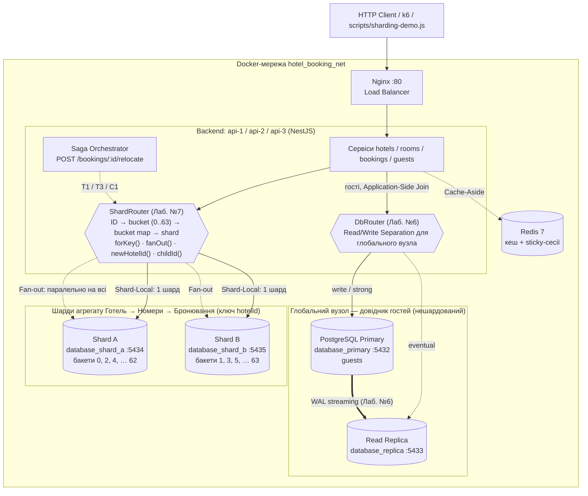

**Що де лежить:**

| Вузол | Таблиці з даними | Чому |
|---|---|---|
| Глобальний (Primary + Replica з Лаб. №6) | `guests` | Невелика таблиця, читається частіше, ніж пишеться; потребує **глобальної** унікальності `email` (UNIQUE працює лише в межах одного вузла). Реплікація з Лаб. №6 продовжує обслуговувати її читання |
| Shard A, Shard B | `hotels`, `rooms`, `bookings` | Ресурсоємний агрегат, що росте: бронювання — найбільша й найчастіше змінювана таблиця |

Схема всіх вузлів однакова (одні й ті самі міграції Prisma) — порожні таблиці не заважають. Без змінної `SHARD_URLS` застосунок працює як у Лаб. №6: усе на глобальному вузлі (шард `global`). Тому Helm-чарт і Kubernetes-маніфести з DevOps-лаб змін не потребують.

**Реплікація шардів.** Кожен шард можна зробити топологією Primary + Replica тим самим механізмом, що в Лаб. №6 (`docker/postgres/*`, слот реплікації, `pg_basebackup -R`). Тут шарди мають лише Primary — щоб не перевантажувати ноутбук (8 контейнерів PostgreSQL замість 4). У схемі реплікація показана для глобального вузла.

**Заголовки відповіді** (видно в Swagger, curl, k6):

| Заголовок | Значення |
|---|---|
| `X-Shard` | на який шард пішов запит (`shard-a`), для fan-out — усі (`shard-a,shard-b`) |
| `X-Shard-Bucket` | номер віртуального бакета ключа (0–63) |
| `X-Shard-Fanout` | кількість шардів у Cross-Shard запиті |
| `X-Shard-Partial` | шарди, що не відповіли (fan-out повернув частковий результат) |
| `X-Instance-ID` | інстанс API (з Лаб. №2) — показує, що маршрут однаковий на всіх інстансах |

---

## 3. п. 2.1 — Dataset і ключ шардингу

### 3.1. Яку сутність шардуємо

Ресурсоємна частина домену — **бронювання** (`bookings`): таблиця росте з кожним бронюванням і ніколи не зменшується, на неї припадають усі записи «гарячого» шляху (`POST /bookings` — Serializable-транзакція з перевіркою перетину дат) і найважчі читання (пошук вільних номерів — `NOT EXISTS` по бронюваннях).

Шардувати лише `bookings` окремо не можна: перевірка «номер вільний на ці дати» читає номер і **всі його бронювання** в одній транзакції. Якщо номер і бронювання опиняться на різних вузлах, транзакція стане розподіленою і захист від подвійного бронювання зламається. Тому шардується **агрегат** `Hotel → Room → Booking` цілком, і всі його частини лежать на одному шарді (co-location).

### 3.2. Порівняння кандидатів у ключ

| Кандидат | Cardinality (потужність) | Query Locality (локальність) | Рівномірність запису | Висновок |
|---|---|---|---|---|
| `booking.id` (сурогатний UUID) | дуже висока | ❌ бронювання одного номера розкидані по шардах → перевірка перетину дат = розподілена транзакція, пошук і картка готелю = fan-out | ✅ | **Не годиться.** Типовий «засліплений» ключ: рівномірний, але ігнорує запити |
| `guestId` | висока | ✅ лише «мої бронювання»; ❌ перевірка доступності номера (найважливіша операція) — по всіх шардах | ✅ | Не годиться: головна транзакція стає Cross-Shard |
| `city` | **дуже низька** (5 міст) | ✅ пошук за містом локальний | ❌ Kyiv = 40 % готелів; подія в місті = весь трафік на один шард. Не більше N_міст шардів | Модель **Hot Shard** (стратегія `city`, розд. 5) |
| `createdAt` / діапазон дат | висока | ❌ | ❌ усі нові записи йдуть на «останній» шард (монотонний ключ) | Не годиться для запису |
| **`hotelId`** ✅ | висока (тисячі готелів, необмежено росте) | ✅ картка готелю з номерами, статистика готелю, **бронювання + перевірка перетину** — усе в межах одного шарду | ✅ після хешування: готелі одного міста розкидані по бакетах | **Обрано** |

**Чому `hotelId`:**
- **Cardinality.** Кожен готель — окреме значення, їх тисячі; це дозволяє рівномірно розкласти дані й мати скільки завгодно шардів (обмеження — 64 бакети).
- **Query Locality.** Усі операції запису і більшість читань стосуються одного готелю: створити номер, забронювати номер, скасувати бронювання, відкрити картку готелю. Вони виконуються на одному шарді, з локальними JOIN і локальною ACID-транзакцією.
- **Захист від колізій.** Ключ — UUID (122 випадкові біти), тож колізії ID практично неможливі. Унікальність `(hotelId, roomNumber)` містить ключ шардингу, тому UNIQUE-індекс працює локально на шарді.
- **Слабке місце** — запити без `hotelId` (пошук за містом, історія гостя, звіти). Вони стають Cross-Shard (fan-out, розд. 6) — це свідома ціна.
- **Ризик «гарячого тенанта».** Один величезний готель цілком лежить на одному шарді. Пом'якшення — винести його бакет на окремий шард через `SHARD_BUCKET_MAP` (розд. 4.4) або складений ключ `hotelId + roomId` (розд. 11).

### 3.3. Зміни схеми для шардингу

Міграція `prisma/migrations/20261031120000_lab7_sharding/migration.sql`:

```sql
ALTER TABLE "bookings" DROP CONSTRAINT "bookings_guestId_fkey";   -- гості на іншому вузлі: FK між вузлами неможливий
CREATE INDEX "bookings_guestId_idx" ON "bookings"("guestId");       -- Cross-Shard запит «бронювання гостя» на кожному шарді
CREATE INDEX "hotels_city_idx" ON "hotels"("city");                  -- пошук і аналітика за містом
```

Зовнішній ключ `bookings.guestId → guests.id` прибрано: гості й бронювання тепер на різних вузлах. Цілісність перевіряє застосунок:
- `POST /bookings` перед транзакцією перевіряє, що гість існує на глобальному вузлі (STRONG);
- `DELETE /guests/:id` робить fan-out по всіх шардах і повертає 409, якщо в гостя є бронювання (замість `ON DELETE RESTRICT`).

FK `rooms → hotels` і `bookings → rooms` залишились — це зв'язки всередині агрегату, а він завжди на одному шарді.

---

## 4. п. 2.2 — Розгортання шардів і Shard Router

### 4.1. Топологія

`docker-compose.sharding.yml` підключається поверх основного compose-файлу:

```bash
docker compose -f docker-compose.yml -f docker-compose.sharding.yml up -d --build
```

Він додає два незалежні PostgreSQL 16 — `db-shard-a` (порт 5434) і `db-shard-b` (порт 5435) — і передає API змінні:

| Змінна | Значення | Призначення |
|---|---|---|
| `SHARD_URLS` | `postgresql://…@db-shard-a…,postgresql://…@db-shard-b…` | Перелік шардів; порядок = індекс у карті бакетів (shard-a, shard-b, …) |
| `SHARD_STRATEGY` | `hash` (за замовчуванням) або `city` | Політика розміщення **нових** готелів |
| `SHARD_BUCKET_MAP` | порожньо або напр. `0-31:0,32-63:1` | Явна карта бакетів (решардинг, ізоляція гарячого бакета) |
| `SAGA_FAULT_INJECTION` | `true` | Дозволяє демонстраційний збій саги (`simulateFailure`) |

Схему на шарди накатує `docker/api/entrypoint.sh` під час старту API: `prisma migrate deploy` для глобального вузла і для кожного URL з `SHARD_URLS`.

### 4.2. Алгоритм маршрутизації (Virtual Buckets + Shard-aware ID)

```
                 hash (FNV-1a) mod 64              bucket map                 пул Prisma
  новий hotelId ───────────────────────▶ bucket ───────────────▶ shard index ───────────▶ PostgreSQL
                                           │
                                           └─ записується в перші 2 hex-символи ID готелю,
                                              його номерів і бронювань:
                                              29190713-… (готель) / 29495343-… (номер) / 29723bc3-… (бронювання)
                                              0x29 = бакет 41 → 41 mod 2 = 1 → shard-b
```

1. **Створення готелю** (`ShardRouter.newHotelId`): генерується UUID v4, бакет = `FNV-1a(uuid) mod 64` (стратегія `hash`) або `FNV-1a(city) mod 64` (стратегія `city`), і номер бакета записується в перший байт ID.
2. **Створення номера / бронювання** (`childId(parentId)`): новий UUID з **тим самим бакетом**, що й у батька. Так увесь агрегат лежить на одному шарді.
3. **Маршрут будь-якого запиту** (`forKey(id)`): `bucket = parseInt(id[0..1], 16) mod 64` → `shard = bucketMap[bucket]`. Таблиця-довідник і звернення до БД не потрібні, складність O(1).
4. **Карта бакетів** за замовчуванням — `bucket mod N` (парні бакети → shard-a, непарні → shard-b), або явна через `SHARD_BUCKET_MAP`.

**Детермінованість.** Маршрут залежить лише від ID і карти бакетів. Вони однакові на всіх інстансах API, тож той самий ID з будь-якого інстансу йде на той самий шард. Це перевіряють тест `маршрут детермінований` і команда `routing` демо-скрипта (4 запити через Nginx потрапляють на різні інстанси, але завжди на той самий шард).

**Ізольованість.** Кожен шард — окремий пул Prisma. Помилка з'єднання з одним шардом дає 503 лише для його ключів (`Shard Unavailable`), решта працює. Fan-out каталогів повертає частковий результат із заголовком `X-Shard-Partial`, а `/health` — `DEGRADED` (розд. 6.4).

**Чому бакет «вшитий» в ID, а не береться з таблиці-довідника.** Шлях `GET /rooms/:id` чи `GET /bookings/:id` не містить `hotelId`. Без бакета в ID довелося б або питати всі шарди (fan-out на кожне читання), або тримати окремий сервіс-довідник `id → shard` (ще один вузол і ще один мережевий виклик). Так само роблять Instagram (shard ID у 64-бітному ID) і Snowflake-подібні генератори.

### 4.3. Реальний вивід (`node scripts/sharding-demo.js routing`)

```
Kyiv
  готель     29190713-9210-446d-b84c-11a9b593c02b  bucket 41  → shard-b
  номер      29495343-b211-4cd1-a626-20f9de09d502  bucket 41  → shard-b
  бронювання 29723bc3-cef2-4f88-9884-235951936613  bucket 41  → shard-b
  GET /bookings/:id 4 рази (інстанс→шард): 4dd7a3→shard-b  12ddcd→shard-b  0abd4a→shard-b  4dd7a3→shard-b

Lviv
  готель     28ba89b5-c758-447d-b838-95d2cf86bddc  bucket 40  → shard-a
  номер      2859a882-6263-4dbd-9e62-0ebe406b2782  bucket 40  → shard-a
  бронювання 286a4714-f97c-4144-9bf0-ea906c77c8c2  bucket 40  → shard-a
```

Перевірка фізичного розміщення напряму в PostgreSQL:

```
database_shard_a: Lviv      (готель 28ba89b5… є лише тут)
database_shard_b: Kyiv      (готель 29190713… є лише тут)
database_primary: —         (на глобальному вузлі готелів нового кластера немає)
```

### 4.4. Решардинг на рівні карти бакетів

Карта бакетів — єдине, що треба змінити, щоб перемістити дані. Приклади:
- `SHARD_BUCKET_MAP="0-62:0,63:1"` — бакет 63 (напр., з «гарячим» мегаготелем) отримує окремий shard-b, решта на shard-a;
- додавання shard-c: `rebalanceBuckets()` (`src/sharding/resharding.ts`) перепризначає рівно 21 з 64 бакетів, решта лишаються на місці (розд. 7).

---

## 5. п. 2.3 — Розподіл даних і Hot Shard

### 5.1. Генерація даних

`node scripts/sharding-demo.js seed -h 200 -r 5 -b 2000` створює через публічний API (тобто через справжній Shard Router):
- 200 готелів з **реалістично нерівномірним** розподілом за містами: Kyiv 40 %, Lviv 20 %, Odesa 15 %, Kharkiv 15 %, Chernivtsi 10 %;
- 1000 номерів (5 на готель), 100 гостей (на глобальному вузлі), 2000 спроб бронювання (≈ 1980 успішних, решта — 409 через перетин дат).

Той самий набір генерується двічі: на порожніх шардах зі стратегією `hash` і зі стратегією `city` (`node scripts/sharding-demo.js reset --strategy city`).

### 5.2. Dataset Distribution Baseline (`GET /sharding/distribution`)

**Стратегія `hash` (FNV-1a + Virtual Buckets):**

| Шард / Вузол | Готелі | Номери | Бронювання | Кількість записів | Частка даних (%) | Частка Write Operations (%) | Зайнятих бакетів |
|---|---|---|---|---|---|---|---|
| Shard A | 101 | 505 | 997 | 1603 | **50.4** | **49.3** | 30 з 32 |
| Shard B | 99 | 495 | 985 | 1579 | **49.6** | **50.7** | 31 з 32 |

Готелі кожного міста діляться приблизно навпіл (Kyiv: 39 / 41, Lviv: 20 / 20, Kharkiv: 15 / 15).

**Стратегія `city` (наївний геошардинг, ключ низької потужності):**

| Шард / Вузол | Готелі | Номери | Бронювання | Кількість записів | Частка даних (%) | Частка Write Operations (%) | Зайнятих бакетів |
|---|---|---|---|---|---|---|---|
| Shard A | 140 | 700 | 1422 | 2262 | **71.1** | **72.6** | 2 з 32 |
| Shard B | 60 | 300 | 560 | 920 | **28.9** | **27.4** | 2 з 32 |

Shard A отримав Kyiv (80 готелів), Lviv (40) і Chernivtsi (20), Shard B — Odesa (30) і Kharkiv (30). Зайнято лише 4 з 64 бакетів — по одному на місто, причому **Kyiv і Chernivtsi потрапили в один бакет** (`FNV-1a("kyiv") mod 64 = FNV-1a("chernivtsi") mod 64 = 2`). Це колізія ключа низької потужності: два міста вже неможливо розвести по різних шардах навіть переналаштуванням карти бакетів.

«Частка Write Operations» — сума `n_tup_ins + n_tup_upd + n_tup_del` з `pg_stat_user_tables` кожного шарду. Це лічильник самого PostgreSQL, тому він не залежить від того, який інстанс API обробив запит.

**Відхилення 50.4 / 49.6 при `hash`** — статистичне: 200 готелів, кожен потрапляє на шард A з імовірністю ½, тож стандартне відхилення ≈ √(200 · ¼) ≈ 7 готелів. Із ростом кількості готелів розподіл прямує до 50 / 50 (закон великих чисел). При `city` нерівномірність **структурна** і з ростом даних не зникає.

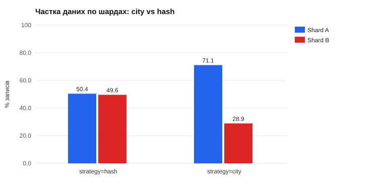

### 5.3. Hot Shard Scenario

**Сценарій.** У Києві подія (конференція, концерт): **90 % бронювань — у готелі Kyiv**, 10 % — в інші міста. Щоб перевантаження проявилось у затримках, CPU кожного шарду обмежено до 0.25 ядра.

```bash
node scripts/sharding-demo.js hot -n 2000 -c 30 --cpus 0.25 --save
```

| Стратегія | Шард | Запитів | Частка запитів | p50, мс | p95, мс | p99, мс | CPU шарду під час сплеску | Throughput |
|---|---|---|---|---|---|---|---|---|
| **city** | Shard A | 1900 | **95 %** | **195.7** | 405.3 | 617.8 | **24.9 % (= ліміт 25 %)** | **150 бронювань/с** |
| | Shard B | 100 | 5 % | 18.1 | 29.9 | 91.7 | 8.3 % | |
| **hash** | Shard A | 978 | 48.9 % | 58.3 | 176.1 | 211.2 | 18.5 % | **301 бронювань/с** |
| | Shard B | 1022 | 51.1 % | 101.0 | 297.3 | 399.1 | 25.6 % | |

**Що видно:**
- **`city` → Hot Shard.** Усі готелі Kyiv в одному бакеті, тож Shard A приймає 95 % записів і впирається в свій ліміт CPU. Затримка на ньому в 10 разів більша, ніж на Shard B (p50 196 мс проти 18 мс), а Shard B майже простоює. Кластер з двох вузлів працює як один перевантажений вузол.
- **`hash` → вирівнювання.** Готелі Kyiv розкидані по 30+ бакетах обох шардів, тож навантаження ділиться ≈ 49 / 51, обидва шарди завантажені. **Пропускна здатність удвічі вища (301 проти 150 бронювань/с)**, і зник «простій» другого вузла.
- p50 на шардах при `hash` не однакові (58 і 101 мс): у Serializable-транзакціях PostgreSQL частина конфліктів залежить від того, які саме номери потрапили в паралельні транзакції. Це видно і в частці tuple-записів, яка включає повтори (розд. 5.5). Результати k6 у розд. 8 згладжують цей шум довгими фазами утримання.

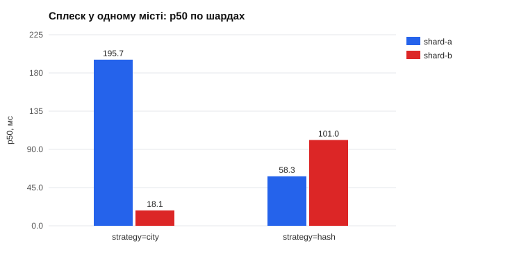

Повне навантажувальне порівняння `city` vs `hash` (сценарій G, k6, 10 → 200 VUs) — у розд. 8.3.

### 5.4. Оптимізація стратегії: від `key % N` до hash + Virtual Buckets

| Підхід | Розподіл при перекосі за містами | Hot tenant / подія | Решардинг |
|---|---|---|---|
| `city % N` (наївний, низька потужність) | повторює перекіс міст (71 / 29), колізії міст у бакеті | увесь трафік міста → один шард | зміна N перераховує все |
| `hash(hotelId) % N` | рівномірний | місто розкидане, один готель — на одному шарді | зміна N переносить ~ (1 − 1/N) даних |
| **`hash(hotelId) % 64 → bucket map`** (реалізовано) | рівномірний | те саме + гарячий бакет можна винести на окремий шард | переносяться лише перепризначені бакети (мінімум) |

### 5.5. Знахідка під час тестування: конфлікти серіалізації

На свіжих шардах із малими таблицями перші прогони дали **10 % відповідей 500**: `Transaction failed due to a write conflict or a deadlock (P2034)`. Причина: PostgreSQL (SSI, рівень `SERIALIZABLE`) ставить predicate lock на сторінку індексу або на всю таблицю (на малих таблицях план — Seq Scan). Через це паралельні бронювання **різних** номерів теж конфліктують, і PostgreSQL скасовує одну з транзакцій.

Виправлення (`BookingsService.serializable`) — стандартне для SERIALIZABLE: **повтор транзакції** (до 5 спроб, випадкова пауза 5–25 мс × номер спроби). Якщо конфлікт не зникає, клієнт отримує 409 «спробуйте ще», а не 500. Після цього 300 паралельних бронювань дали 300 × 201, а наступні тести — Error Rate 0 %. Повтори видно в лічильниках `xact_rollback` шардів і в частці tuple-записів (вона включає скасовані спроби).

---

## 6. п. 2.4 — Cross-Shard запити і розподілені транзакції

### 6.1. Які запити стали Cross-Shard

| Ендпоінт | Чому без ключа шардингу | Як виконується |
|---|---|---|
| `GET /rooms/search?city=…` | місто ≠ `hotelId` | fan-out на всі шарди, злиття списків. При стратегії `city` — **локально** на шарді міста (Query Locality — єдина перевага наївного ключа) |
| `GET /guests/:id/bookings` | бронювання шардовані за готелем, не за гостем | fan-out, злиття, сортування за `createdAt` в API |
| `GET /sharding/analytics/cities` | звіт по всіх готелях | fan-out з **частковими агрегатами** (`GROUP BY city` на кожному шарді) + підсумовування в API |
| `GET /hotels`, `/rooms`, `/bookings` | повні списки | fan-out, `allowPartial` |
| `DELETE /guests/:id` | перевірка «немає бронювань» замість FK | fan-out **без** `allowPartial`: недоступний шард = 503, а не хибне «бронювань немає» |

Shard-Local аналоги для порівняння: `GET /rooms/:id`, `GET /bookings/:id`, `GET /sharding/analytics/hotels/:id` (статистика одного готелю: один SQL-запит з JOIN на одному шарді).

### 6.2. Як працює Fan-out (`ShardRouter.fanOut`)

```ts
const settled = await Promise.allSettled(this.shards.map((shard) => shard.read((db) => query(db, shard))));
// fulfilled → parts[], rejected → throw (або failed[], якщо allowPartial)
```

- Запити на шарди йдуть **паралельно**: час ≈ найповільніший шард + злиття в API, а не сума.
- **Scatter-Gather з частковою агрегацією.** Шард повертає не сирі рядки, а підсумки (`COUNT`, `SUM` по місту), тож мережею йдуть кілька рядків замість тисяч. Підсумовувати можна лише **адитивні** агрегати. `COUNT(DISTINCT hotel)` тут адитивний, бо кожен готель живе рівно на одному шарді. `AVG` чи глобальний `COUNT DISTINCT` по ключу, що не є ключем шардингу, так зібрати не можна (треба передавати `SUM` і `COUNT` окремо або множини).
- **Distributed JOIN неможливий.** Бронювання (шард) і гість (глобальний вузол) не з'єднати SQL-запитом, тож `GET /bookings` робить **Application-Side Join**: один запит `WHERE id IN (…)` у глобальний вузол замість JOIN.
- **Пагінацію й сортування** при fan-out робить координатор (API). Для `LIMIT k` кожен шард має повернути до `k` рядків, а API зливає N відсортованих списків.

### 6.3. Оверхед Fan-out: затримка одного запиту

`node scripts/sharding-demo.js latency -n 200 --save` — 200 послідовних запитів на ендпоінт, **Redis зупинено** (міряється PostgreSQL, а не кеш), 200 готелів / 1000 номерів / ~2000 бронювань:

| Ендпоінт | Тип | Шардів | p50, мс | p95, мс |
|---|---|---|---|---|
| `GET /rooms/:id` | Shard-Local | 1 | 4.0 | 4.8 |
| `GET /bookings/:id` | Shard-Local + App-Side Join з глобальним вузлом | 1 (+ global) | 5.5 | 6.5 |
| `GET /sharding/analytics/hotels/:id` | Shard-Local (JOIN + агрегат) | 1 | 3.2 | 4.2 |
| `GET /guests/:id/bookings` | Cross-Shard | 2 | 5.8 | 8.2 |
| `GET /rooms/search` | Cross-Shard | 2 | **14.3** | **30.4** |
| `GET /sharding/analytics/cities` | Cross-Shard (часткові агрегати) | 2 | 4.7 | 5.5 |

**Висновки:**
- Без навантаження fan-out коштує ≈ +1–2 мс на ендпоінт (`guests/:id/bookings` 5.8 мс проти 3–4 мс локальних). Запити на шарди паралельні, тому з двома шардами оверхед малий.
- Важкий fan-out (пошук з `NOT EXISTS` по бронюваннях) виконується **на кожному шарді**. Шардинг не зменшує його сумарну вартість, а розподіляє її, і хвіст p95 визначає найповільніший шард.
- Під навантаженням різниця росте: fan-out займає з'єднання й CPU **на всіх** шардах одночасно, тож додавання шарду майже не збільшує пропускну здатність Cross-Shard запитів (розд. 8.2).
- `GET /bookings/:id` дорожчий за `GET /rooms/:id` на ~1.5 мс — це ціна Application-Side Join (другий мережевий виклик до глобального вузла).

### 6.4. Ізоляція збою шарду (`node scripts/sharding-demo.js isolation`)

```
GET готель на shard-a: 200
GET готель на shard-b: 503 Шард shard-b недоступний: дані інших шардів продовжують обслуговуватися
GET /hotels (fan-out): 200, готелів 109 з 206, X-Shard-Partial: shard-b
GET /health: DEGRADED shards={"shard-a":"CONNECTED","shard-b":"DISCONNECTED"}
```

Збій одного шарду зачіпає лише його частку ключового простору: це перевага шардингу над одним вузлом (blast radius = 1/N).

### 6.5. Cross-Shard Write: переселення гостя в інший номер (`POST /bookings/:id/relocate`)

**Сценарій.** Гостя переселяють у номер іншого готелю на ті самі дати. Треба атомарно: (1) зайняти новий номер (з перевіркою перетину), (2) скасувати старе бронювання. Якщо готелі на різних шардах, це **мутація двох незалежних PostgreSQL**.

**Чому не локальна ACID-транзакція.** `BEGIN … COMMIT` працює в межах одного з'єднання з одним сервером. Shard A не знає про транзакцію на Shard B. Можна закомітити на одному й не встигнути на іншому (збій мережі, процесу, конфлікт), і тоді гість лишиться з двома бронюваннями або без жодного.

**Реалізовано два шляхи:**

1. **Той самий шард → одна локальна Serializable-транзакція** (перевірка + нове бронювання + скасування старого атомарні). Це аргумент на користь правильного ключа: що більше операцій лишається в межах агрегату, то рідше потрібні розподілені транзакції.

2. **Різні шарди → Saga (оркестрація) з компенсацією:**

| Крок | Шард | Дія | Якщо невдача |
|---|---|---|---|
| T1 | цілі | Локальна Serializable-транзакція: перевірити перетин і створити нове бронювання зі статусом **PENDING** (семантичне блокування: номер уже зайнятий, але бронювання ще не «справжнє») | Зупинка, компенсувати нічого |
| T2 | джерела | `UPDATE … SET status = CANCELLED WHERE id = … AND status IN (PENDING, CONFIRMED)` — умовне, ідемпотентне | **C1:** скасувати резерв T1 (`WHERE status = PENDING` — ідемпотентно) |
| T3 | цілі | Перевести нове бронювання у статус старого (CONFIRMED / PENDING) | — (T2 уже виконано; T3 повторюється) |

Реальний вивід `node scripts/sharding-demo.js saga`:

```
1) Той самий шард (номер 101 → 102, обидва на shard-a): локальна ACID-транзакція
  HTTP 200  mode: local-transaction  shard-a → shard-a
    reserve + cancel (one ACID transaction)    shard-a  done

2) Різні шарди (shard-a → shard-b): Saga T1 → T2 → T3
  HTTP 200  mode: saga  shard-a → shard-b
    T1 reserve new room (PENDING)              shard-b  done
    T2 cancel original booking                 shard-a  done
    T3 set status PENDING                      shard-b  done
    старе бронювання: CANCELLED (shard-a); нове: PENDING (shard-b)

3) Збій перед T2 (simulateFailure): компенсація C1 скасовує резерв на shard-b
  HTTP 409  mode: saga  shard-a → shard-b
    T1 reserve new room (PENDING)              shard-b  done
    T2 cancel original booking                 shard-a  failed
    C1 cancel reservation (compensation)       shard-b  compensated
    оригінал: PENDING (не зачеплено); резерв: CANCELLED (компенсовано)
```

**Обмеження саги (чесно):**
- **Немає ізоляції (I з ACID).** Між T1 і T2 інші запити бачать два активні бронювання гостя. Це прийнятно, бо нове має статус PENDING (семантичне блокування).
- Журнал саги тут у пам'яті й повертається у відповіді. У продакшні стан саги зберігають у БД (таблиця `saga_log` або Transactional Outbox), щоб після падіння процесу продовжити або компенсувати незавершені саги. Компенсації мають бути **ідемпотентними** (у нас — умовні `UPDATE … WHERE status = …`), бо їх можуть повторювати.

### 6.6. 2PC vs Saga vs перепроєктований агрегат

| | 2PC (Two-Phase Commit) | Saga | Шард-локальний агрегат |
|---|---|---|---|
| Атомарність | так (координатор: PREPARE → COMMIT) | eventual: компенсації відкочують семантично | так (одна локальна транзакція) |
| Ізоляція | так (блокування до COMMIT) | **ні** — проміжні стани видимі | так |
| Доступність | блокується при падінні координатора між фазами (in-doubt транзакції тримають блокування) | висока: кожен крок — коротка локальна транзакція | висока |
| Затримка | 2 мережеві раунди + утримання блокувань | кроки послідовні, але без глобальних блокувань | 1 транзакція |
| У PostgreSQL | `PREPARE TRANSACTION` / `COMMIT PREPARED` (потрібен `max_prepared_transactions > 0` і зовнішній координатор із журналом) | на рівні застосунку | — |
| Коли | рідкісні операції, де потрібна сувора атомарність, а вузли надійні | бізнес-процеси між сервісами / шардами | **найкраще**: так обрати ключ, щоб транзакція не виходила за шард |

У проєкті: бронювання й скасування (99 % записів) — **шард-локальні** завдяки ключу `hotelId`. Saga — лише для рідкісного переселення між готелями різних шардів. 2PC не обрано через блокування й залежність від координатора.

---

## 7. п. 2.5 — Решардинг і Consistent Hashing

### 7.1. Математична модель

Нехай хеш ключа `h` рівномірний, кластер росте з `N` до `M` шардів.

**Наївний `shard = h mod N`.** Ключ лишається на місці, лише якщо `h mod N = h mod M`. Це виконується для `h ≡ r (mod lcm(N, M))`, `r < min(N, M)`, отже:

```
частка, що лишається = min(N, M) / lcm(N, M)
частка, що переїжджає = 1 − min(N, M) / lcm(N, M)
```

- 2 → 3: 1 − 2/6 = **66.7 %**; 3 → 4: 1 − 3/12 = **75 %**; 4 → 5: 1 − 4/20 = **80 %**. Для N → N + 1 це N / (N + 1): **майже 100 % даних** при великих N.
- Окремий випадок — подвоєння (2 → 4): 1 − 2/4 = 50 %, що збігається з мінімумом. Тому деякі системи дозволяють лише подвоєння кластера.

**Теоретичний мінімум.** Після розширення кожен шард має тримати 1/M даних, тож новим шардам треба отримати (M − N)/M даних:

```
мінімальна частка переїзду = (M − N) / M      (для N → N + 1: 1 / (N + 1))
```

**Virtual Buckets (реалізовано).** Ключ → один із B = 64 бакетів (фіксовано), бакет → шард за картою. При N → M новий шард забирає ⌊B/M⌋ бакетів у найбільш завантажених старих, решта карти не змінюється (`rebalanceBuckets`). Переїжджає `перепризначені бакети / B ≈ (M − N)/M`, тобто мінімум. Похибка — через цілочисельність: 64 не ділиться на 3 чи 5.

**Consistent Hashing.** Кільце 0…2³²: кожен шард ставить V точок (віртуальних вузлів), ключ належить першій точці за годинниковою стрілкою. Новий шард вставляє свої V точок і забирає лише сусідні відрізки, тобто в середньому (M − N)/M ключів. При V = 1 відрізки дуже нерівні; що більше V, то ближча до рівномірності частка кожного шарду (дисперсія ∝ 1/V).

### 7.2. Симуляція на 100 000 ключів (`GET /sharding/resharding`, `src/sharding/resharding.ts`)

| Перехід | `key % N` | Virtual Buckets (64) | Consistent Hashing (128 vnodes) | Теоретичний мінімум |
|---|---|---|---|---|
| 2 → 3 | **66.8 %** | 32.8 % | 33.5 % | 33.3 % |
| 2 → 4 | 50.3 % | 50.2 % | 52.4 % | 50.0 % |
| 3 → 4 | **75.1 %** | 25.0 % | 28.3 % | 25.0 % |
| 4 → 5 | **80.2 %** | 18.8 % | 19.3 % | 20.0 % |

Рівномірність після розширення (max / avg навантаження шарду): modulo 1.00–1.01, Virtual Buckets 1.01–1.03, Consistent Hashing 1.09–1.13.

**Навіщо віртуальні вузли** (кільце, 4 шарди):

| Віртуальних вузлів на шард | Max / Avg | Частки шардів, % |
|---|---|---|
| 1 | **1.80** | 22.2 / 45.1 / 27.8 / 4.9 |
| 16 | 1.52 | 37.9 / 19.6 / 15.6 / 26.9 |
| 128 | 1.13 | 23.0 / 24.5 / 24.3 / 28.3 |
| 512 | **1.04** | 23.6 / 25.4 / 25.1 / 25.9 |

З одним вузлом на шард один сервер отримує 45 % ключів, а інший 5 %. 512 віртуальних вузлів дають відхилення ≤ 4 %.

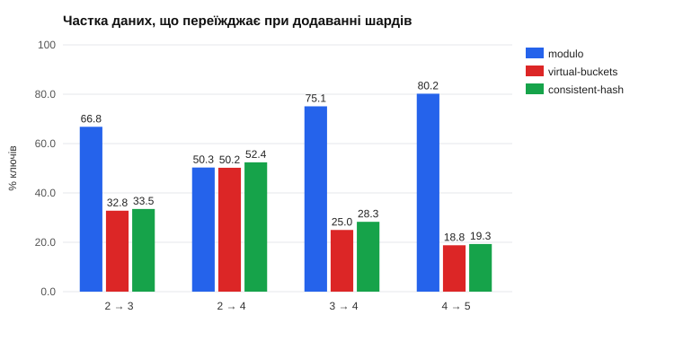

**Знахідка.** Перша версія кільця брала позиції віртуальних вузлів через FNV-1a від рядків `shard-0#1`, `shard-0#2`, …, і при 128 vnodes дисбаланс був 1.42, а 4 → 5 переносило 32 % замість 20 %. FNV-1a погано перемішує схожі короткі рядки, тож точки на кільці скупчувались. Позиції тепер беруться з MD5 (як у класичному Ketama), і результати збіглися з теорією. Для ключів (UUID) FNV-1a лишився: вони й так випадкові.

### 7.3. Порівняння Virtual Buckets і Consistent Hashing

| | Virtual Buckets (обрано) | Consistent Hashing |
|---|---|---|
| Об'єм переїзду | мінімальний, точний (керуємо картою) | мінімальний в середньому, з розкидом |
| Рівномірність | точна (рахуємо бакети) | залежить від кількості vnodes |
| Метадані | карта на 64 елементи — легко зберігати, передавати, версіонувати | позиції точок (обчислюються з імен шардів) |
| Гарячий бакет / тенант | переноситься вручну на окремий шард | складно: точки фіксовані хешем |
| Де використовується | Couchbase (vBuckets), Redis Cluster (16384 hash slots), Elasticsearch (shards), Vitess | Cassandra, DynamoDB, Riak, Memcached-клієнти (Ketama) |

Обмеження Virtual Buckets: максимальна кількість шардів = кількість бакетів (64). Число бакетів обирають із запасом заздалегідь: змінити його — це повний решардинг.

### 7.4. Процедура перенесення бакета (як це робиться наживо)

1. **Copy:** скопіювати рядки бакета (`WHERE substr(id,1,2) = 'xx'` у `hotels`, `rooms`, `bookings`) на новий шард (`COPY` / logical replication за фільтром).
2. **Catch-up / freeze:** коротко заблокувати записи в бакет (або писати в обидва шарди) і докопіювати зміни.
3. **Switch:** опублікувати нову карту (`SHARD_BUCKET_MAP`, у продакшні — з версіонованого конфігу / etcd), щоб усі інстанси почали ходити на новий шард.
4. **Cleanup:** видалити рядки бакета зі старого шарду.

Оскільки бакет записаний в ID, ID об'єктів **не змінюються**: змінюється лише карта.

---

## 8. п. 2.6 — Порівняння продуктивності

### 8.1. Методика

```powershell
npm run load:sharding        # = run-load-tests.ps1 -Experiment sharding -ApplyLimits  (≈ 50 хв)
npm run load:report-sharding # load-tests/results-lab7/SUMMARY.md + charts/*.svg
```

| Параметр | Значення |
|---|---|
| Хост | Intel Core i7-12700H (14 ядер / 20 потоків), 31.6 ГБ RAM; Docker Desktop 20 CPU / 15.4 ГБ |
| Генератор | k6 1.0.0 в окремому контейнері (2 CPU), запити напряму до Nginx |
| Профіль | розігрів 30 с → 10 → 25 → 50 → 100 → 200 VUs, утримання 60 с на ступені, пауза 0.1 с; метрики лише з фаз утримання |
| API | 3 інстанси × 1 CPU / 512 МБ, пул Prisma `connection_limit=10` до кожного вузла |
| Шарди | **0.25 CPU кожен** (`-DbCpus`): вузьким місцем має бути СУБД, як у Лаб. №6 |
| Глобальний вузол (гості) | 1 CPU — не є предметом порівняння |
| Redis | вимкнено: кожне читання доходить до шардів |
| Дані | перед кожним прогоном шарди перестворюються порожніми; `setup()` k6 створює через API 40 готелів × 10 номерів (міста Kyiv 40 % / Lviv 20 % / Odesa 15 % / Kharkiv 15 % / Chernivtsi 10 %), 100 гостей, для F ще 2000 бронювань |
| Single Node | той самий код і той самий Shard Router, але `SHARD_URLS` = лише shard-a (усі 64 бакети на одному вузлі) |

Точка насичення — перший ступінь, де RPS росте менш ніж наполовину від приросту VUs, або p95 зростає > 3 рази, або Error Rate > 1 % (критерії Лаб. №5).

### 8.2. Single Node vs Sharded

**Shard-Local операції (сценарій E: 55 % картка готелю, 15 % статистика готелю, 30 % бронювання + скасування):**

| VUs | 1 шард: RPS | 2 шарди: RPS | 1 шард: p95 / p99, мс | 2 шарди: p95 / p99, мс |
|---|---|---|---|---|
| 10 | 118.9 | 117.7 | 12.0 / 54.8 | 11.8 / 42.6 |
| 25 | **283.2** | 295.1 | 58.5 / 100.9 | 13.7 / 80.1 |
| 50 | 256.8 | **515.8** | 302.8 / 501.7 | **93.1 / 194.4** |
| 100 | 242.2 | 471.3 | 793.4 / 1008.1 | 414.6 / 674.3 |
| 200 | 221.0 | 417.0 | 1892.4 / 2412.2 | 1206.5 / 1898.0 |

| Метрика | Single Node | Sharded (2) | Ефект |
|---|---|---|---|
| Пік Throughput | 283.2 RPS | 515.8 RPS | **× 1.82** |
| Точка насичення | 25 VUs | 50 VUs | зсунулась удвічі |
| p95 на 50 VUs | 302.8 мс | 93.1 мс | **у 3.3 рази менше** |
| Commit/с на шардах | A 347 / B 0 | A 303 / B 249 | навантаження поділено ≈ 55 / 45 |
| Error Rate | 0 % | 0 % до 100 VUs; 0.09 % (23 × 5xx) на 200 VUs | див. нижче |

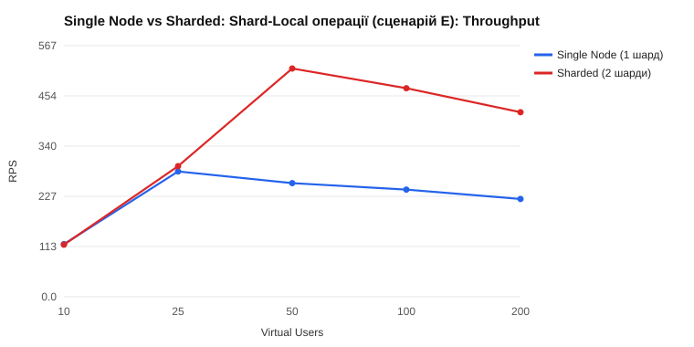

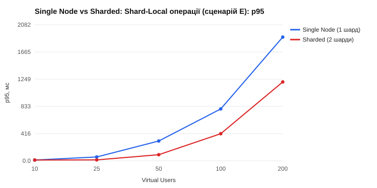

**Cross-Shard Fan-out (сценарій F: 40 % пошук, 40 % історія гостя, 20 % аналітика за містами):**

| VUs | 1 шард: RPS | 2 шарди: RPS | 1 шард: p95 / p99, мс | 2 шарди: p95 / p99, мс |
|---|---|---|---|---|
| 10 | 90.6 | 91.0 | 15.8 / 78.3 | 16.2 / 69.5 |
| 25 | 177.8 | 215.6 | 106.6 / 200.9 | 77.3 / 102.0 |
| 50 | **189.7** | 268.0 | 388.8 / 498.5 | 201.5 / 299.2 |
| 100 | 187.2 | 268.1 | 870.7 / 1005.1 | 595.9 / 765.9 |
| 200 | 180.8 | **276.9** | 2001.9 / 2321.0 | 1312.2 / 1507.0 |

| Метрика | Single Node | Sharded (2) | Ефект |
|---|---|---|---|
| Пік Throughput | 189.7 RPS | 276.9 RPS | **× 1.46** (проти × 1.82 для Shard-Local) |
| Точка насичення | 25 VUs | 25–50 VUs | майже не зсунулась |
| Commit/с на шардах | A 339 / B 0 | A 453 / B 453 | **кожен запит виконується на обох шардах** |
| Транзакцій СУБД на 1 HTTP-запит | 339 / 190 ≈ 1.8 | 905 / 277 ≈ 3.3 | **× 1.8 більше роботи СУБД** |
| Error Rate | 0 % | 0 % | — |

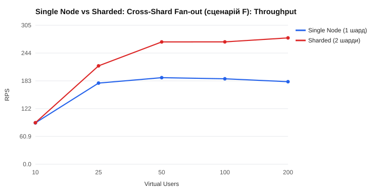

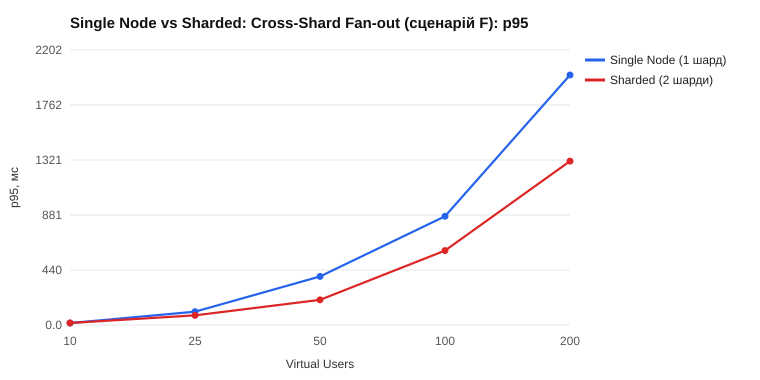

### 8.3. Hot Shard під навантаженням (сценарій G, 2 шарди)

90 % бронювань (кожне + скасування) — у готелі Kyiv, однакові дані, змінюється лише `SHARD_STRATEGY`:

| VUs | `city`: RPS | `hash`: RPS | `city`: p95 / p99, мс | `hash`: p95 / p99, мс |
|---|---|---|---|---|
| 10 | 162.2 | 164.9 | 22.9 / 92.7 | 16.2 / 74.4 |
| 25 | **295.2** | 374.3 | 98.3 / 196.0 | 63.8 / 103.1 |
| 50 | 277.5 | **453.4** | 293.2 / 396.8 | 187.3 / 268.8 |
| 100 | 267.9 | 445.6 | 698.6 / 1197.1 | 502.3 / 731.3 |
| 200 | 272.7 | 450.0 | 1594.9 / 1893.0 | 1423.6 / 2001.6 |

| Метрика | `city` (наївна) | `hash` + Virtual Buckets |
|---|---|---|
| Записи Shard A / Shard B | **94.9 % / 5.1 %** | 43.7 % / 56.3 % |
| CPU шардів, середнє під навантаженням (ліміт 25 %) | **A 21.5 % / B 3.4 %** | A 15.4 % / B 20.1 % |
| Commit/с A / B | 340.5 / 18.9 | 230.8 / 296.5 |
| Пік Throughput | 295.2 RPS (на 25 VUs, далі падає) | **453.4 RPS (× 1.54)** |
| Насичення | 25 VUs | 50 VUs |
| p95 на 50 / 100 VUs | 293 / 699 мс | **187 / 502 мс** |

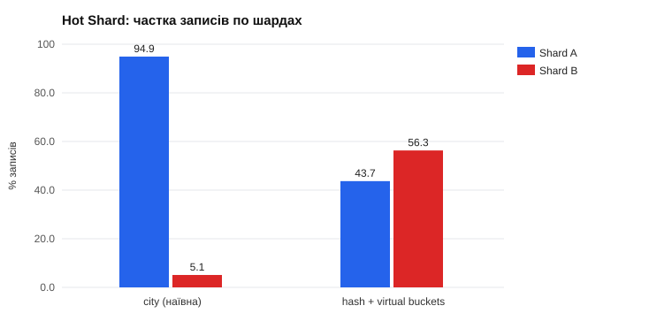

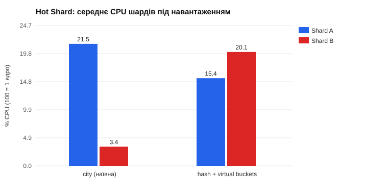

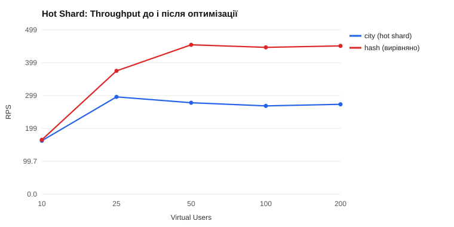

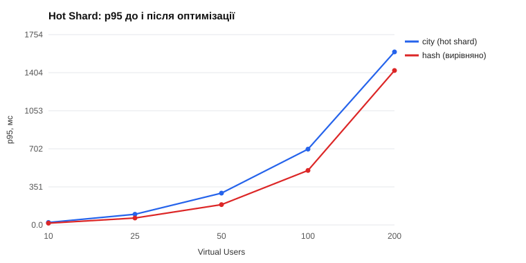

У k6-наборі лише 16 готелів Kyiv, тож при `hash` вони лягли 44 / 56 (випадковий розклад малої вибірки, стандартне відхилення ≈ √(16 · ¼) = 2 готелі). Навіть так другий шард працює, а при `city` він простоює.

### 8.4. Висновки

1. **Шардинг масштабує запис і Shard-Local читання майже лінійно:** другий вузол дав × 1.82 пікової пропускної здатності і в 3.3 рази меншу p95 на 50 VUs. Ідеальне × 2 не досягнуто через нерівний розподіл 40 готелів (55 / 45) і спільний глобальний вузол (перевірка гостя на кожному бронюванні).
2. **Cross-Shard запити масштабуються гірше (× 1.46):** кожен fan-out виконується на **всіх** шардах, і СУБД робить у 1.8 рази більше транзакцій на один HTTP-запит. Виграш є лише тому, що на кожному шарді половина даних. Із ростом кількості шардів частка fan-out запитів має бути малою, інакше додавання вузлів перестає допомагати.
3. **Невдалий ключ шардингу «з'їдає» другий вузол:** при `city` Shard A приймає 95 % записів і впирається в CPU, Shard B простоює, а пік пропускної здатності на 35 % нижчий, ніж при `hash` (295 проти 453 RPS). Hash + Virtual Buckets вирівнює навантаження без зміни коду сервісів, лише зміною політики розміщення.
4. **Помилки.** До точки насичення помилок немає (0 %). На 200 VUs, далеко за насиченням, з'явилось 0.09–0.15 % відповідей 5xx (23 і 40 запитів). Логи API на той момент не збереглись: контейнери перестворюються між прогонами. Найімовірніша причина — тайм-аут відкриття з'єднання (`connect_timeout=2 с`) до шарду з CPU 0.25 під чергою з 200 клієнтів. 409 (зайняті дати або вичерпані повтори серіалізації) — коректні бізнес-відповіді.
5. Колонка «Стабільний Throughput» у `SUMMARY.md` для E / F / G показує значення на 10–25 VUs: критерій «p95 зріс > 3 рази» спрацьовує вже на першому кроці, бо при 10 VUs система майже не навантажена. Для порівняння топологій коректніше брати **пік RPS** і p95 на однакових VUs (таблиці вище).

Повні таблиці всіх прогонів, графіки p99 і HTML-дашборди k6 — у [`load-tests/results-lab7/`](../load-tests/results-lab7/SUMMARY.md).

---

## 9. Що робить кожен файл

### 9.1. Нові файли

| Файл | Для чого | Що всередині |
|---|---|---|
| `src/sharding/shard-key.ts` | «Математика» ключа шардингу: чисті функції без залежностей від NestJS / БД, тому легко тестуються | `BUCKETS = 64`; `fnv1a()` — 32-бітний хеш FNV-1a; `bucketOf(id)` — бакет з перших 2 hex-символів ID (для чужих рядків — через хеш); `idInBucket(bucket)` — UUID v4 з номером бакета в першому байті; `bucketForNewHotel(strategy, uuid, city)` — стратегії `hash` / `city`; `buildBucketMap(N, spec)` — карта `bucket → shard` (за замовчуванням `bucket mod N`, або з `SHARD_BUCKET_MAP` з валідацією); `shardName(i)` → `shard-a`, `shard-b` |
| `src/sharding/shard-router.service.ts` | **Shard Router** — центральна частина лаби: єдине місце, яке вирішує, на який вузол іде запит | Читає `SHARD_URLS` / `SHARD_STRATEGY` / `SHARD_BUCKET_MAP`; для кожного шарду створює окремий `PrismaClient` (свій пул). Без `SHARD_URLS` — один шард `global` поверх `DbRouter` з Лаб. №6. Методи: `forKey(id)` (Shard-Local), `fanOut(query, {allowPartial})` (Scatter-Gather через `Promise.allSettled`, заміри часу кожного шарду), `fanOutList`, `newHotelId`, `childId`, `shardForCity` (Query Locality для `city`), `describe`. Помилка з'єднання → 503 `Shard Unavailable` лише для цього шарду. Health-check (`SELECT 1` з тайм-аутом), лічильники reads / writes / fan-out, заголовки `X-Shard*` через `AsyncLocalStorage` |
| `src/sharding/sharding.service.ts` | Діагностика й аналітика кластера | `distribution()` — Dataset Distribution Matrix (fan-out: `count()` трьох таблиць, `pg_stat_user_tables` для write-операцій, зайняті бакети, `groupBy(city)`); `hotelStats(id)` — Shard-Local аналітика одного готелю; `cityAnalytics()` — Cross-Shard аналітика з частковими агрегатами і злиттям; `resharding()` — запуск симуляції |
| `src/sharding/sharding.controller.ts` | HTTP-ендпоінти для демонстрації (видно в Swagger, тег `sharding`) | `GET /sharding/status`, `/route/:id`, `/distribution`, `/analytics/hotels/:id`, `/analytics/cities`, `/resharding?keys=` |
| `src/sharding/sharding.module.ts` | NestJS-модуль | `@Global()` — `ShardRouter` доступний усім сервісам без імпорту модуля |
| `src/sharding/resharding.ts` | Модель решардингу (п. 2.5) | `HashRing` — кільце Consistent Hashing (позиції vnodes з MD5, бінарний пошук); `rebalanceBuckets()` — мінімальне перепризначення бакетів при N → M; `simulateResharding()` — частка ключів, що переїжджає, для modulo / virtual buckets / consistent hash + рівномірність; `ringBalance()` — вплив кількості vnodes |
| `src/sharding/sharding.spec.ts` | Юніт-тести шардингу (13 тестів) | Детермінованість FNV-1a, кодування бакета в ID, `city` кладе місто в 1 бакет / `hash` розкидає, карта бакетів і її валідація, co-location агрегату, однаковий маршрут на різних інстансах, Query Locality для `city`, теорія решардингу (modulo > 60–70 %, buckets / ring ≈ мінімум), рівно 21 бакет переходить при 2 → 3 |
| `src/bookings/dto/relocate-booking.dto.ts` | Тіло `POST /bookings/:id/relocate` | `roomId` (UUID нового номера), `simulateFailure?` (демонстраційний збій саги) |
| `prisma/migrations/20261031120000_lab7_sharding/migration.sql` | Зміна схеми під шардинг | `DROP CONSTRAINT bookings_guestId_fkey` (FK між вузлами неможливий), індекси `bookings(guestId)` і `hotels(city)` |
| `docker-compose.sharding.yml` | Sharded Architecture Topology | Сервіси `db-shard-a` (:5434), `db-shard-b` (:5435) на `postgres:16` з healthcheck, без іменованих томів (порожній шард — `--renew-anon-volumes`); для `api-1..3` — `SHARD_URLS`, `SHARD_STRATEGY`, `SHARD_BUCKET_MAP`, `SAGA_FAULT_INJECTION`, `depends_on` шардів |
| `docker/api/entrypoint.sh` | Старт контейнера API | `prisma migrate deploy` для глобального вузла, потім для кожного URL із `SHARD_URLS`, далі `exec node dist/main`. Паралельний старт 3 інстансів безпечний (advisory lock у Prisma) |
| `scripts/sharding-demo.js` | Живі демонстрації на захисті (без залежностей, лише Node.js) | Команди `status`, `reset --strategy hash\|city`, `seed`, `routing`, `distribution`, `hot`, `latency`, `saga`, `resharding`, `isolation`, `report-data`; `--save` пише JSON у `load-tests/results-lab7/`. `latency` зупиняє Redis на час вимірювання; `hot` прогріває пули і знімає CPU асинхронно |
| `load-tests/scenario-e-shard-local.js` | k6, сценарій E — Shard-Local | 55 % `GET /hotels/:id`, 15 % `GET /sharding/analytics/hotels/:id`, 30 % `POST /bookings` + `PATCH …/cancel` |
| `load-tests/scenario-f-cross-shard.js` | k6, сценарій F — Fan-out | 40 % `GET /rooms/search`, 40 % `GET /guests/:id/bookings`, 20 % `GET /sharding/analytics/cities`; у `setup()` створює `SEED_BOOKINGS` бронювань |
| `load-tests/scenario-g-hot-shard.js` | k6, сценарій G — Hot Shard | 90 % (`HOT_SHARE`) бронювань у місті `HOT_CITY` (Kyiv), кожне + скасування |
| `load-tests/lib/sharding.js` | Спільні функції сценаріїв F і G | `seedBookings()` — пакетне створення бронювань (`http.batch` по 20), `splitByCity()` — номери «гарячого» міста і решта |
| `load-tests/docker-compose.sharding-loadtest.yml` | Ліміти для навантажувального тесту | Шарди по 1 CPU / 1 ГБ (скрипт додатково знижує до `-DbCpus`), `SHARD_URLS` з `connection_limit=10&pool_timeout=10` (як для глобального вузла в Лаб. №5–6) |
| `load-tests/docker-compose.one-shard.yml` | Single Database Node для порівняння | `SHARD_URLS` лише з shard-a: той самий код і Shard Router, усі 64 бакети на одному вузлі |
| `load-tests/report-sharding.js` | Зведений звіт Лаб. №7 | Читає `results-lab7/*.json`, `*-db.json`, `*-docker-stats.csv`; рахує точку насичення (ті самі критерії, що в Лаб. №5), CPU шардів, частку записів; пише `results-lab7/SUMMARY.md` і SVG-графіки (лінійні й стовпчикові) |
| `load-tests/results-lab7/` | Результати | `SUMMARY.md`, `charts/*.svg`, JSON прогонів k6 і демо-скрипта, `*-docker-stats.csv`, HTML-дашборди k6 |
| `docs/LAB7.md` | Цей звіт | — |

### 9.2. Змінені файли

| Файл | Що змінено і чому |
|---|---|
| `src/hotels/hotels.service.ts` | `DbRouter` → `ShardRouter`. `create` генерує ID у бакеті (`newHotelId(city)`) і пише на шард; `findOne` / `update` / `remove` — `forKey(id)`; `findAll` — fan-out з `allowPartial`. Кеш (Cache-Aside з Лаб. №4) без змін |
| `src/rooms/rooms.service.ts` | `create` — перевірки й запис на шарді готелю, ID номера в бакеті готелю (`childId`); `findOne` / `update` / `remove` — за ID номера; `findAll` і `search` — fan-out (або локально для стратегії `city`). Заборона переносу номера в готель іншого бакета (ключ шардингу незмінний) — 400 |
| `src/bookings/bookings.service.ts` | Бронювання на шарді номера, ID у тому ж бакеті. Гість перевіряється на глобальному вузлі (`DbRouter`), `findAll` / `findOne` — Application-Side Join з гостями. Новий `serializable()` — повтор транзакції при конфлікті серіалізації (P2034) до 5 разів, далі 409. Новий `relocate()` — локальна транзакція або **Saga** (T1 / T2 / T3 + компенсація C1) з журналом кроків у відповіді. `PATCH` зі зміною номера на інший бакет — 400 (лише через relocate) |
| `src/bookings/bookings.controller.ts` | Ендпоінт `POST /bookings/:id/relocate` з описом у Swagger |
| `src/guests/guests.service.ts` | Гості лишаються на глобальному вузлі. `findBookings` — Cross-Shard fan-out + сортування в API. `remove` — fan-out-перевірка бронювань на **всіх** шардах замість FK (409, якщо є) |
| `src/health/health.controller.ts` | `/health` перевіряє і шарди: поле `shards`, статус `DEGRADED`, якщо шард недоступний (а не `DOWN`: решта ключів працює) |
| `src/app.module.ts` | Підключено `ShardingModule` |
| `prisma/schema.prisma` | Прибрано зв'язок `Booking.guest` / `Guest.bookings` (FK між вузлами), додано `@@index([guestId])` і `@@index([city])` |
| `Dockerfile` | Копіює `docker/api/entrypoint.sh` і запускає його замість `prisma migrate deploy && node dist/main` |
| `load-tests/run-load-tests.ps1` | Експеримент `sharding` (`-ShardRuns local,fanout,hot`, `-SeedHotels`, `-SeedBookings`, `-SeedCityWeights`); `Set-ShardTopology` — порожні шарди, 1 або 2 шарди, стратегія, ліміт CPU; лічильники кожного шарду (`commits`, `writes`) у `*-db.json`; результати в `results-lab7`; **відновлення оригінального `nginx.conf`** наприкінці (раніше скрипт лишав `roundrobin`) |
| `load-tests/lib/data.js` | `SEED_CITY_WEIGHTS` — нерівномірний розподіл готелів за містами; у список номерів додано `city` (для сценарію G) |
| `load-tests/lib/summary.js` | `RESULTS_DIR` — каталог результатів (Лаб. №7 пише в `results-lab7`) |
| `src/bookings/bookings.service.spec.ts` | Мок `ShardRouter` з двома «шардами»; тести App-Side Join, повтору P2034 і 409 після 5 спроб, саги (локальна транзакція, T1 → T2 → T3, компенсація, зупинка на T1, заборона для скасованих) |
| `src/*/*.spec.ts` (інші) | Додано провайдер-заглушку `ShardRouter` |
| `package.json` | Скрипти `shard:*`, `load:sharding`, `load:report-sharding` |
| `README.md` | Розділ про Лаб. №7 і посилання на цей звіт |

---

## 10. Запуск і сценарій захисту

### 10.1. Підняти кластер

```bash
# Збірка і запуск: глобальний вузол (Primary + Replica), 2 шарди, Redis, 3 API, Nginx
docker compose -f docker-compose.yml -f docker-compose.sharding.yml up -d --build

node scripts/sharding-demo.js status            # sharded (2 shards), strategy hash, по 32 бакети
node scripts/sharding-demo.js seed              # 200 готелів, 1000 номерів, 100 гостей, ~2000 бронювань
```

Swagger: `http://localhost/api/docs` → тег **sharding** і `POST /bookings/{id}/relocate`.

### 10.2. Порядок демонстрації

| # | Що показати | Команда | На що звернути увагу |
|---|---|---|---|
| 1 | Аргументація ключа | розд. 3.2 цього файлу | Cardinality, Query Locality, рівномірність; чому не `booking.id` / `guestId` / `city` |
| 2 | Детермінована маршрутизація | `node scripts/sharding-demo.js routing` | Готель, номер і бронювання мають однаковий бакет і шард; 4 запити через різні інстанси → той самий шард |
| 3 | Фізично на різних вузлах | `docker exec database_shard_a psql -U postgres -d hotel_booking -c "select city, count(*) from hotels group by 1"` (те саме для `database_shard_b`) | Дані справді розділені між двома PostgreSQL |
| 4 | Distribution Matrix | `node scripts/sharding-demo.js distribution` | ≈ 50 / 50 при `hash` |
| 5 | Hot Shard | `node scripts/sharding-demo.js reset --strategy city` → `seed` → `distribution` → `hot --cpus 0.25` | 71 / 29 даних, 2 бакети на шард, 95 % записів і p50 ~200 мс на Shard A |
| 6 | Оптимізація | `reset --strategy hash` → `seed` → `hot --cpus 0.25` | ≈ 50 / 50, пропускна здатність ×2 |
| 7 | Fan-out vs Local | `node scripts/sharding-demo.js latency` | `X-Shard-Fanout: 2`, пошук — найдорожчий; таблиця 6.3 |
| 8 | Розподілена транзакція | `node scripts/sharding-demo.js saga` | `local-transaction` vs `saga`, компенсація C1 |
| 9 | Ізоляція збою | `node scripts/sharding-demo.js isolation` | 200 / 503, `X-Shard-Partial`, `/health` DEGRADED |
| 10 | Решардинг | `node scripts/sharding-demo.js resharding` | modulo 67–80 % vs buckets / ring ≈ 1/M |
| 11 | Продуктивність | `load-tests/results-lab7/SUMMARY.md` | Розд. 8 |

Повний навантажувальний тест (≈ 50 хв): `npm run load:sharding`, звіт — `npm run load:report-sharding`. Після нього шарди порожні, тож перед демонстрацією знову запустіть `seed`.

### 10.3. Повернення до конфігурації Лаб. №6

```bash
docker compose -f docker-compose.yml -f docker-compose.sharding.yml down     # або просто:
docker compose up -d                                                           # API без SHARD_URLS → усе на глобальному вузлі
```

---

## 11. Теоретичні питання

**Партиціювання vs шардинг vs реплікація.**
- **Партиціювання** — поділ однієї таблиці на частини **в межах одного сервера** (PostgreSQL `PARTITION BY RANGE / LIST / HASH`). Дає partition pruning, швидке видалення старих даних (`DROP PARTITION`), менші індекси. Проте CPU, пам'ять і диск один, тож запис не масштабується.
- **Шардинг** — горизонтальне партиціювання **між серверами**: кожен вузол має власні CPU, диск і пул з'єднань і зберігає лише частину рядків. Масштабує і запис, і об'єм. Ціна — Cross-Shard запити, розподілені транзакції, решардинг.
- **Реплікація** — **повні копії** тих самих даних на кількох вузлах (Лаб. №6). Масштабує читання й дає відмовостійкість, але кожна репліка мусить виконати **всі** записи. Тому запис і об'єм реплікацією не масштабуються.
- Їх поєднують: кожен шард = Primary + Replicas (MongoDB, Vitess, Citus). У нашому проєкті глобальний вузол реплікований, а шарди можна реплікувати тим самим механізмом.

**Distributed JOINs.** JOIN між таблицями на різних вузлах у SQL неможливий. Варіанти:
1. **Co-location**: шардувати пов'язані таблиці за одним ключем (`hotels`, `rooms`, `bookings` за `hotelId`), щоб JOIN був локальним (у Citus це «co-located tables»).
2. **Reference / broadcast tables**: малі довідники копіюються на кожен шард (у Citus — reference tables).
3. **Application-Side Join**: два запити й з'єднання в коді (у нас — бронювання + гості, `WHERE id IN (…)`).
4. Денормалізація: зберігати потрібні поля поруч.

Distributed JOIN двох великих таблиць за не-шардовим ключем вимагає перерозподілу (shuffle) даних між вузлами — це дорого, тому ключ обирають так, щоб його уникати.

**Unique constraints.** UNIQUE-індекс гарантує унікальність лише **всередині одного шарду**. Глобальна унікальність можлива, якщо:
- унікальний ключ **містить** ключ шардингу: `(hotelId, roomNumber)` → обидва записи гарантовано на одному шарді (у нас так);
- унікальність перевіряється на окремому глобальному вузлі (у нас — `guests.email`) або через окрему lookup-таблицю, шардовану за цим полем;
- ID генеруються без координації (UUID, Snowflake), щоб первинні ключі не конфліктували між шардами. Автоінкремент (`SERIAL`) на кожному шарді дає дублікати ID.

**2PC (Two-Phase Commit).** Координатор: фаза 1 — `PREPARE` на всіх учасниках (кожен гарантує, що зможе закомітити, і тримає блокування); фаза 2 — `COMMIT` (або `ROLLBACK`, якщо хтось відмовив). Дає атомарність і ізоляцію. Мінуси: блокування тримаються всі 2 раунди; якщо координатор упав після PREPARE, учасники зависають в in-doubt стані з блокуваннями (blocking protocol); латентність = найповільніший учасник. В PostgreSQL є `PREPARE TRANSACTION`, але координатор (з журналом рішень) потрібно писати самому.

**Saga.** Послідовність локальних транзакцій T1…Tn, для кожної є компенсація C1…Cn-1. При збої на кроці k виконуються Ck-1…C1. Дає атомарність «врешті-решт», але **без ізоляції**: проміжні стани видимі. Пом'якшення — семантичні блокування (статус PENDING), комутативні оновлення, повторне читання перед кроком. Буває **оркестрація** (центральний координатор — як наш `relocate`) і **хореографія** (кроки запускаються подіями). Вимоги: ідемпотентні кроки й компенсації, збережений журнал саги (Transactional Outbox).

**Consistent Hashing.** Хеш-простір замкнений у кільце, вузли й ключі хешуються на нього, ключ належить першому вузлу за годинниковою стрілкою. Додавання або видалення вузла переносить лише ключі з його сусіднього відрізка: ≈ K/N ключів замість ≈ K при `mod N`. Віртуальні вузли (V точок на сервер) вирівнюють розподіл і дозволяють задавати вагу (потужніший сервер = більше vnodes). Альтернативи: Virtual Buckets / hash slots (Redis Cluster — 16384 слоти), Rendezvous (HRW) hashing, Jump Consistent Hash.

**Hot Shard: причини і боротьба.** Причини: ключ низької потужності (`city`, `country`), монотонний ключ (`createdAt`, автоінкремент → усі вставки в «останній» шард), «великий тенант» або вірусний об'єкт. Боротьба:
- ключ високої потужності з хешуванням (у нас `hash` замість `city`);
- Virtual Buckets: перенести гарячий бакет на окремий / потужніший вузол;
- **складений ключ** (`hotelId + roomId`) або **salting** (`hotelId + random(0..k)`) для одного гігантського тенанта. Тоді операції, що мають бути атомарними в межах готелю, перестають бути локальними, тож це крайній захід (у нас атомарність потрібна в межах номера, тож `hotelId:roomId` був би допустимим компромісом);
- кешування гарячих читань (Лаб. №4), черги для згладжування сплесків записів.

**Ціна Cross-Shard запитів.** Fan-out навантажує **всі** шарди: N запитів замість одного, затримка = найповільніший шард (tail latency зростає з N), злиття, сортування й пагінація в координаторі, частково доступний результат при збої шарду. Додавання шардів майже не збільшує пропускну здатність fan-out запитів, тому ключ обирають під домінуючий профіль запитів, а рідкісні глобальні звіти виносять у репліку / аналітичне сховище (OLAP, CDC → ClickHouse).

**CAP і шардинг.** Шардинг сам по собі не змінює CAP-вибору кожного шарду: у нас кожен шард — один PostgreSQL (CP). Але **доступність кластера** стає частковою: при падінні шарду недоступна 1/N даних, решта працює (graceful degradation).
