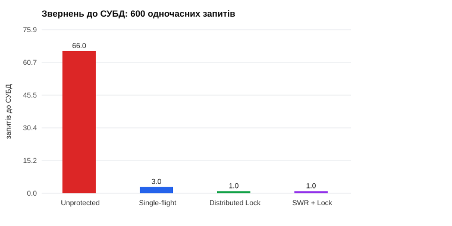
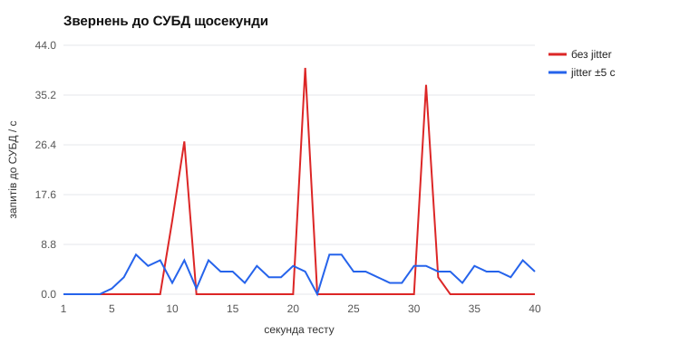

# Лабораторна робота №8 — Resilience Engineering: Cache Stampede, Thundering Herd, Cache Penetration

## 1. Мета

Перевірити, що відбувається з базою даних, коли популярного ключа немає в кеші і до нього одночасно звертаються сотні клієнтів. Відтворити Cache Stampede, Thundering Herd і Cache Avalanche, виміряти їх, а потім усунути:
- координацією запитів: Single-flight, розподілене блокування в Redis, Stale-While-Revalidate;
- рандомізацією TTL (TTL Jitter);
- кешуванням відповіді «не знайдено» (Negative Caching).

## 2. Що потрібно було зробити і як зроблено

| Пункт | Що вимагалось | Як зроблено |
|---|---|---|
| 2.1 | Обрати коштовний популярний read-ресурс у Redis і пояснити, чому Cache Miss для нього критичний | `GET /hotels/:id/stats` — статистика готелю: номери, бронювання за статусами, виручка, майбутні заїзди (розд. 3) |
| 2.2 | Force Expire + 500+ одночасних запитів, сплеск навантаження на СУБД | `resilience-demo.js stampede`: Force Expire, потім k6 — 600 VUs по одному запиту одночасно. Звернення до СУБД рахуються в `pg_stat_statements`, пік паралельних запитів — у `pg_stat_activity` |
| 2.3 | Синхронне вигасання групи ключів (Avalanche) | `resilience-demo.js avalanche --jitter off`: 40 ключів з однаковим TTL 10 с |
| 2.4 | Distributed Lock / Single-flight / SWR | реалізовано всі три в `src/resilience/resilient-cache.service.ts`, режим перемикається без перезапуску |
| 2.5 | TTL Jitter: TTL = Base ± Random | `jitteredTtl()`: TTL = 60 ± 15 с для статистики і 600 ± 60 с для картки готелю |
| 2.6 | Запити до неіснуючих id + Negative Caching | «не знайдено» кешується на 30 с для `/hotels/:id` і `/hotels/:id/stats` |
| 2.7 | Порівняльна матриця і аналіз Failure Modes | розд. 5 і 6, графіки — у `load-tests/results-lab8/` |
| 3 | Код, звіт з графіками, Resilience Profile | цей документ, розд. 7 і `load-tests/results-lab8/SUMMARY.md` |

## 3. Обраний ресурс (п. 2.1)

`GET /hotels/:id/stats` відкривається разом із карткою кожного готелю, тому його читають найчастіше. Один SQL-запит агрегує всі бронювання всіх номерів готелю: `COUNT`, `SUM`, `FILTER` і два `LATERAL`-підзапити. Чим довше живе готель, тим запит дорожчий.

На демо-даних він виконується за мілісекунди. Тому вартість «важкої аналітики» змодельовано параметром `statsQueryCostMs = 200`: `pg_sleep(0.2)` виконується в тому самому запиті. Кожне звернення займає з'єднання з пулу і роботу СУБД на 200 мс.

**Чому промах кешу тут критичний.** У звичайному режимі майже всі запити — HIT (~10 мс). Коли ключ зникає, усі клієнти, що прийшли за ці 200 мс, одночасно йдуть у БД з однаковим запитом. Пули з'єднань трьох API заповнюються (за замовчуванням Prisma — 21 з'єднання на інстанс; у піку ми бачили 63 = 3 × 21 одночасні запити), і в чергу стають уже й інші запити до того самого шарду.

## 4. Як працює захист

```
GET /hotels/:id/stats
  └─ ResilientCacheService.getOrLoad(key)
       ├─ single-flight: такий самий запит уже йде в цьому інстансі?  → чекати його результат (COALESCED)
       ├─ Redis GET: свіже значення                                    → HIT / NEGATIVE
       ├─ застаріле, режим swr                                         → віддати STALE, оновити у фоні під lock
       └─ немає (lock / swr): SET key:lock <token> NX PX 5000
             ├─ отримали lock  → ще раз GET → запит у СУБД → SET key EX ttl±jitter → зняти lock (Lua: лише свій токен)
             └─ lock зайнятий  → опитувати кеш кожні 20–50 мс (LOCK-WAIT), не довше 3 с → потім самим у СУБД
```

| Режим (`protection`) | Що робить | Звернень до СУБД на один промах |
|---|---|---|
| `none` | звичайний Cache-Aside | скільки запитів прийшло, поки йшло завантаження |
| `singleflight` | об'єднує однакові запити в межах **одного** процесу (Map ключ → Promise) | 1 на інстанс (у нас 3) |
| `lock` | single-flight + блокування в Redis (`SET NX PX`) | **1 на кластер** |
| `swr` | lock + Stale-While-Revalidate: ключ живе в Redis на 60 с довше за TTL, після TTL віддається застаріле значення, а оновлює один інстанс у фоні | **1**, і ніхто не чекає |

- **Захист від deadlock.** Блокування має TTL 5 с. Якщо власник «помер», Redis сам зніме lock.
- **Хто знімає блокування.** Lua-скрипт видаляє lock лише за власним токеном, тож чужий lock не зачіпається.
- **Обмеження чекання.** Очікувачі чекають не довше `lockWaitMs` = 3 с. Далі запит іде в СУБД сам (fail-open), щоб клієнт не отримав помилку.
- **Повторна перевірка.** Після отримання lock кеш читається ще раз (double-check), щоб не завантажувати значення, яке щойно поклав попередній власник.

**Конфігурація** — `PUT /resilience/config`. Вона зберігається в Redis, і кожен інстанс перечитує її раз на секунду. Тому режим, jitter і negative caching перемикаються на всіх трьох API одночасно, без перезапуску.

**Лічильники** спільні для всіх інстансів (`GET /resilience`): `dbLoads`, `hits`, `coalesced`, `lockWaits`, `lockTimeouts`, `staleServed`, `negativeHits` тощо. Звернення до СУБД рахуються двома незалежними способами: лічильником API (`dbLoads`) і `pg_stat_statements.calls` на шарді. Обидва збігаються в кожному прогоні.

## 5. Результати вимірювань

Середовище:
- Docker Desktop, 3 інстанси API за nginx, Redis, 2 шарди PostgreSQL 16 (топологія Лаб. №7);
- k6 1.0.0 у контейнері в мережі кластера;
- запит статистики коштує 200 мс.

Графіки й сирі дані — `load-tests/results-lab8/`.

### 5.1. Cache Stampede: Force Expire + 600 одночасних запитів (п. 2.2, 2.4)

| Режим | Запитів до СУБД | Пік одночасних запитів у СУБД | RPS | p95, мс | p99, мс | Error Rate |
|---|---|---|---|---|---|---|
| Unprotected | **66** | **40** | 396 | 1063 | 1111 | 0 % |
| Single-flight | 3 | 3 | 677 | 360 | 417 | 0 % |
| Distributed Lock | **1** | **1** | 845 | 462 | 496 | 0 % |
| SWR + Lock | **1** | 1 | 1196 | 208 | 300 | 0 % |

Без захисту 66 клієнтів одночасно виконали той самий важкий запит, і в піку в шарді працювало 40 таких запитів (Thundering Herd). Блокування зводить звернення до **1** на весь кластер. Single-flight дає 3, бо координує лише свій процес, а інстансів API три.



### 5.2. Порівняльна матриця (п. 2.7): k6, 500 VUs × 30 с, ключ вигасає кожні 5 с

| Режим / Показник | Кількість запитів до СУБД | Throughput (RPS) | p95 Latency | p99 Latency | Error Rate |
|---|---|---|---|---|---|
| Unprotected (Stampede) | **915** | 929 | 99 мс | 516 мс | 0 % |
| Single-flight | 18 | 917 | 148 мс | 258 мс | 0 % |
| Protected (Distributed Lock) | **6** | 943 | 150 мс | 220 мс | 0 % |
| Protected (SWR + Lock) | **6** | 963 | 55 мс | 139 мс | 0 % |

За 30 с ключ вигасав 6 разів. Без захисту це дало 915 важких запитів до СУБД, з блокуванням — рівно 6, тобто по одному на кожне вигасання.

**Чому p95 у `lock` вища, ніж без захисту.** Під час кожного оновлення всі запити, що прийшли за ці ~200 мс, чекають на нього, плюс до 50 мс на інтервал опитування. Таких запитів понад 5 %, тому це видно в p95. Без захисту ці запити теж чекають, але кожен — на власне звернення до БД, і їх менше 5 %. Ціна такого режиму — навантаження на СУБД: 915 запитів проти 6. Стрибки затримки прибирає SWR: p99 = 139 мс проти 516 мс без захисту.

Генератор працював з паузою 0,5 с між запитами VU (~1000 RPS). Без паузи 500 VUs упираються в CPU трьох API на HIT-запитах, і затримка відображає загальне перевантаження, а не роботу кешу.

### 5.3. Cache Avalanche і TTL Jitter (п. 2.3, 2.5): 40 ключів, TTL 10 с, 40 клієнтів

| TTL | Пік звернень до СУБД за 1 с | p95 найгіршої секунди |
|---|---|---|
| 10 с, без jitter | **40** (усі ключі в одну секунду, кожні 10 с) | **204 мс** |
| 10 ± 5 с | **7** | **17,5 мс** |

Без jitter усі ключі прогріто одночасно, тож вони одночасно й вигасають. Кожні 10 с СУБД отримує 40 важких запитів за секунду, RPS падає вдвічі, p95 зростає в 13 разів. З jitter ті самі оновлення розподілено рівномірно, і p95 щосекунди лишається ~14 мс.



### 5.4. Cache Penetration і Negative Caching (п. 2.6): 3000 запитів до 50 неіснуючих готелів

| Negative Caching | Запитів до СУБД | RPS | p95 | p99 |
|---|---|---|---|---|
| вимкнено | **2223** | 192 | 506 мс | 785 мс |
| увімкнено | **50** | 2239 | 22 мс | 252 мс |

Без захисту кожен запит до неіснуючого id пробиває кеш, бо «нічого» не кешується. З Negative Caching до СУБД доходить рівно один запит на кожен id, а наступні 30 с відповідь `404` приходить з Redis із заголовком `X-Cache: NEGATIVE`.

## 6. Failure Modes: ризики самого захисту

| Ризик | Що відбувається | Як оброблено в коді |
|---|---|---|
| **Deadlock** (власник lock впав) | інші чекали б вічно | TTL блокування 5 с (`PX`). Чекання обмежене 3 с, далі запит іде в БД сам (fail-open). Перевірено тестом «власник помер» |
| **Lock Expiration Timeout** (запит до БД довший за TTL lock-а) | lock зникає, другий запит теж іде в БД; перший потім може зняти чужий lock | зняття через Lua з перевіркою токена (тест «не знімає чужого блокування»). Дубль — лише зайве звернення, не помилка. `lockTtlMs` має бути більшим за найдовший запит |
| **Очікувачі під час оновлення** | усі запити до ключа чекають ~200 мс, p95 зростає | обмеження 3 с, а для гарячих ключів — SWR |
| **Застарілі дані при SWR** | після TTL до 60 с віддається старе значення | вікно `swrStaleSec` налаштовується. Статистика — аналітика, кількасекундне відставання припустиме |
| **Статистика не інвалідується після бронювання** | нове бронювання видно в статистиці через ≤ 75 с (TTL 60 ± 15) | свідомий вибір: інвалідація на кожен запис спричиняла б Stampede після кожного бронювання. Картка й статистика інвалідуються при зміні чи видаленні готелю |
| **Пам'ять під Negative Cache** | атака з унікальними випадковими id: кожен id — новий ключ (~150 Б), користі нуль | короткий TTL 30 с; Redis має `maxmemory 128mb` + `allkeys-lru`. Для такої атаки потрібен Bloom Filter (розд. 9) |
| **Negative Cache і щойно створений запис** | id, запитаний до створення, 30 с давав би 404 | ID готелю генерує сервер у момент створення, тож запитати його заздалегідь неможливо. Оновлення чи видалення готелю видаляє ключ |
| **Single-flight у кластері** | координує лише свій процес: N інстансів = N звернень | поверх нього — розподілений lock |
| **Redis недоступний** | немає ні кешу, ні блокувань | BYPASS: читання напряму з БД (graceful degradation з Лаб. №4). Захисту від Stampede в цьому режимі немає — це свідомий компроміс на користь доступності |

## 7. Resilience Profile системи

| Загроза | Захист | Залишковий ризик |
|---|---|---|
| Промах гарячого ключа (Stampede / Thundering Herd) | `lock` (за замовчуванням) або `swr`: 1 звернення до БД на кластер | очікувачі чекають на одне завантаження, ≤ 3 с |
| Масове вигасання (Avalanche) | TTL Jitter ± 25 % (60 ± 15 с, 600 ± 60 с) | прогрів після холодного старту Redis — одночасний, далі розсіюється |
| Запити до неіснуючих id (Penetration) | Negative Caching, 30 с | атака з унікальними id (потрібен Bloom Filter) |
| Відмова Redis | BYPASS на Replica / шард (Лаб. №4, №6) | БД без захисту від Stampede |
| Відмова Primary / шарду | Read-Only Mode, ізоляція шарду (Лаб. №6, №7) | закешовані дані шарду ще віддаються до кінця TTL |
| Відмова інстансу API | nginx `max_fails` + `proxy_next_upstream` (Лаб. №3) | — |

## 8. Файли

| Файл | Що в ньому |
|---|---|
| `src/resilience/resilient-cache.service.ts` | **ядро лаби**: `getOrLoad` з режимами none / singleflight / lock / swr, розподілене блокування (`SET NX PX` + зняття через Lua), SWR із фоновим оновленням, Negative Caching, `jitteredTtl()`, примусове вигасання |
| `src/resilience/resilience-config.service.ts` | конфігурація захисту (значення з env, перевизначення в Redis, перечитування раз на секунду) і лічильники `HINCRBY`, спільні для всіх інстансів |
| `src/resilience/resilience.controller.ts` | `GET /resilience`, `PUT /resilience/config`, `POST /resilience/config/reset`, `POST /resilience/metrics/reset`, `POST /resilience/expire` (зміна стану лише з `RESILIENCE_ADMIN=true`) |
| `src/resilience/dto/update-resilience-config.dto.ts` | валідація параметрів конфігурації |
| `src/resilience/resilience.module.ts` | глобальний модуль |
| `src/resilience/*.spec.ts` | 14 юніт-тестів: stampede без захисту = 50 звернень, single-flight = 1 (а 3 інстанси = 3), lock на 3 інстанси = 1, «власник помер», таймаут чекання, чужий lock, SWR, negative caching, BYPASS, межі jitter, часткове оновлення конфігурації |
| `src/hotels/hotels.service.ts` | ресурс `stats()` (один SQL з `pg_sleep` у CTE і маркером `stats_cost`), `statsCached()`; картка готелю `findOneCached()` переведена на захищений кеш з Negative Caching; інвалідація статистики при зміні чи видаленні готелю |
| `src/hotels/hotels.controller.ts` | `GET /hotels/:id/stats`; 404 з `X-Cache: NEGATIVE` |
| `src/cache/cache-keys.ts`, `cache.service.ts` | ключ `booking:hotel-stats:{id}`; доступ до клієнта Redis для блокувань |
| `docker-compose.resilience.yml` | змінні Лаб. №8 для API: режим за замовчуванням, TTL, `STATS_QUERY_COST_MS=200`, `RESILIENCE_ADMIN=true` |
| `docker-compose.yml`, `docker-compose.sharding.yml` | `shared_preload_libraries=pg_stat_statements` на Primary і шардах — лічильник запитів на боці СУБД |
| `nginx.conf` | `worker_connections 4096`: 600 одночасних клієнтів = 1200 з'єднань (клієнт + upstream) |
| `scripts/resilience-demo.js` | демонстрація і вимірювання: `stampede`, `compare`, `avalanche`, `penetration`, `k6`, `k6-all`, `status`, `config`, `reset` |
| `load-tests/scenario-h-stampede.js` | k6: `burst` (N VUs × 1 запит одночасно) і `sustained` (500 VUs × 30 с) |
| `load-tests/report-resilience.js` | `results-lab8/SUMMARY.md` і 7 SVG-графіків |
| `load-tests/results-lab8/` | сирі результати (JSON), звіт, графіки |

## 9. Запуск і демонстрація на захисті

```powershell
npm run res:up                                                   # кластер: 3 API + Redis + 2 шарди + налаштування Лаб. №8
node scripts/sharding-demo.js seed                               # якщо даних ще немає

# 1. Cache Stampede наживо: Force Expire + 600 одночасних запитів, без захисту
node scripts/resilience-demo.js stampede --mode none -n 600      # десятки звернень до СУБД, пік паралельних запитів

# 2. Захист: той самий тест з Distributed Lock
node scripts/resilience-demo.js stampede --mode lock -n 600      # звернень до СУБД: 1

# 3. Negative Caching
node scripts/resilience-demo.js penetration --negative off       # тисячі звернень до СУБД
node scripts/resilience-demo.js penetration --negative on        # рівно по 1 на id

# Додатково
node scripts/resilience-demo.js avalanche --jitter off           # 40 звернень в одну секунду кожні 10 с
node scripts/resilience-demo.js avalanche --jitter on            # розсіяно
node scripts/resilience-demo.js compare -n 600 --save            # матриця всіх режимів (залп)
node scripts/resilience-demo.js k6-all                           # матриця k6, 500 VUs (~3 хв)
npm run load:report-resilience                                   # SUMMARY.md + графіки
```

Вручну: `curl -i localhost/hotels/<id>/stats` (заголовок `X-Cache`), `GET localhost/resilience` (лічильники). Swagger: `localhost/api/docs`, розділ `resilience`.

## 10. Теорія (для захисту)

- **Cache Stampede (Dog-piling)** — популярний ключ зник, і багато запитів одночасно виконують те саме дороге обчислення, щоб його відновити.
- **Thundering Herd** — наслідок на боці ресурсу: сотні клієнтів одночасно «прокидаються» й б'ють в одну СУБД. У нас це 40 одночасних однакових запитів у шарді.
- **Cache Avalanche** — одночасне вигасання **багатьох** ключів (однаковий TTL після прогріву) або падіння всього кешу. Навантаження на БД стрибає в розмірі всієї групи. Ліки — TTL Jitter, прогрів з розкидом, резервування кешу.
- **Cache Penetration** — запити до даних, яких **немає**. Їх неможливо закешувати як звичайні значення, тож кожен пробиває кеш до БД. Часто це атака або бот. Ліки — Negative Caching або Bloom Filter.
- **Redlock** — алгоритм Redis для блокування на N незалежних master-вузлах: lock вважається отриманим на більшості (N/2+1) вузлів за час, менший за TTL. Він захищає від падіння одного Redis.
  - У нас один Redis, тому достатньо `SET NX PX`.
  - Блокування тут потрібне для **ефективності** (не робити роботу двічі), а не для коректності: дубль запиту безпечний.
  - Для коректності (взаємне виключення записів) потрібні fencing tokens: критика Redlock (М. Клеппман) — про паузи GC і розбіжність годинників.
- **Bloom Filter** — бітовий масив і k хеш-функцій: «точно немає» або «можливо є». Хибних «немає» не буває, хибні «є» бувають з імовірністю ≈ (1 − e^(−kn/m))^k. Фільтр з усіма id відсіює запити до неіснуючих id без БД навіть для унікальних випадкових id, тобто там, де Negative Caching безсилий.
  - Мінуси: фільтр треба тримати синхронним з БД (додавати при створенні), видаляти елементи неможливо (потрібен Counting Bloom Filter), у кластері його треба зберігати спільно (Redis bitmap / RedisBloom).
- **Probabilistic Early Expiration (XFetch)** — кожен запит з певною ймовірністю сам оновлює ключ **до** закінчення TTL. Умова оновлення: `now − Δ · β · ln(rand()) ≥ expiry`, де Δ — тривалість обчислення, β ≈ 1. Що ближче до кінця TTL і що дорожче обчислення, то вища ймовірність.
  - Блокування не потрібне, ключ майже ніколи не зникає.
  - Ціна — зрідка кілька паралельних оновлень.
  - У нас аналогічну задачу розв'язує SWR + lock: оновлення рівно одне, але після «м'якого» TTL.
- **Trade-offs.**
  - Lock зменшує навантаження на БД, але додає затримку очікувачам і нову залежність (Redis) у критичному шляху.
  - SWR прибирає очікування ціною застарілих даних.
  - Jitter прибирає Avalanche ціною непередбачуваного TTL окремого ключа.
  - Negative Caching захищає БД ціною пам'яті й короткої затримки появи нових записів.
