# Результати Лаб. №7 — Sharding

Згенеровано: 2026-10-31 21:01 (node load-tests/report-sharding.js)

## Baseline Environment Specification

Знято: 2026-10-31 22:16

| Параметр | Значення |
|---|---|
| Хост (CPU) | 12th Gen Intel(R) Core(TM) i7-12700H, 14 ядер / 20 потоків |
| Хост (RAM) | 31.6 ГБ |
| Docker Desktop | 20 CPU, 15.4 ГБ RAM |
| Ліміти контейнерів | load-tests/docker-compose.loadtest.yml: api 1 CPU / 512 МБ, db-primary 1 CPU / 1 ГБ, db-replica 1 CPU / 1 ГБ, redis 0.5 CPU / 256 МБ, nginx 1 CPU / 256 МБ |
| Backend | NestJS 10 (Node.js 24 у контейнері), 3 інстанси за Nginx (Round Robin), для Scaling — 1 інстанс |
| Пул з'єднань БД | connection_limit=10, pool_timeout=10 с на інстанс до кожного вузла БД |
| БД | PostgreSQL 16: Primary + Read Replica (асинхронна streaming replication); для Лаб. №5 і Single Primary читання йдуть на Primary |
| Кеш | Redis 7, maxmemory 128 МБ, allkeys-lru (для Caching — вимкнений / теплий) |
| Генератор навантаження | grafana/k6:1.0.0 в окремому контейнері, ліміт 2 CPU, мережа кластера (запити напряму до nginx) |
| Профіль | розігрів 30 с, ступені 10,25,50,100,200 VUs, перехід 10 с, утримання 60 с, пауза 0.1 с |
| Node.js на хості | v25.2.0 |

## Стан контейнерів

```
NAMES                 IMAGE                 STATUS
hotel_booking_nginx   booking-hotel-nginx   Up 10 seconds
database_replica      postgres:16           Up 11 seconds (healthy)
hotel_booking_api_2   backend-api-2         Up 11 seconds
hotel_booking_api_3   backend-api-3         Up 11 seconds
hotel_booking_api_1   backend-api-1         Up 11 seconds
database_primary      postgres:16           Up 17 seconds (healthy)
hotel_booking_redis   redis:7-alpine        Up 17 seconds (healthy)
database_shard_a      postgres:16           Up About a minute (healthy)
database_shard_b      postgres:16           Up About a minute (healthy)
```


## Методика

- k6 у Docker-контейнері, ступені 10 → 25 → 50 → 100 → 200 VUs, метрики лише з фаз утримання (як у Лаб. №5–6).
- Redis вимкнено: кожне читання доходить до шардів. CPU кожного шарду обмежено (`-DbCpus`), щоб вузьким місцем була СУБД.
- Перед кожним прогоном шарди перестворюються порожніми, дані створює `setup()` k6 через API (Shard Router розміщує їх сам).
- Single Node = той самий код із одним шардом у `SHARD_URLS` (усі 64 бакети на shard-a).

## Dataset Distribution Matrix (п. 2.3)

Згенеровано `node scripts/sharding-demo.js distribution` після `seed` (однаковий набір даних, різна стратегія розміщення).

### Стратегія `hash`

| Шард / Вузол | Готелі | Номери | Бронювання | Кількість записів | Частка даних (%) | Частка Write Operations (%) | Зайнятих бакетів | Готелі за містами |
|---|---|---|---|---|---|---|---|---|
| shard-a | 101 | 505 | 997 | 1603 | 50.4 | 49.3 | 30 | Lviv 20, Odesa 14, Chernivtsi 13, Kyiv 39, Kharkiv 15 |
| shard-b | 99 | 495 | 985 | 1579 | 49.6 | 50.7 | 31 | Lviv 20, Odesa 16, Chernivtsi 7, Kyiv 41, Kharkiv 15 |

### Стратегія `city`

| Шард / Вузол | Готелі | Номери | Бронювання | Кількість записів | Частка даних (%) | Частка Write Operations (%) | Зайнятих бакетів | Готелі за містами |
|---|---|---|---|---|---|---|---|---|
| shard-a | 140 | 700 | 1422 | 2262 | 71.1 | 72.6 | 2 | Lviv 40, Chernivtsi 20, Kyiv 80 |
| shard-b | 60 | 300 | 560 | 920 | 28.9 | 27.4 | 2 | Odesa 30, Kharkiv 30 |

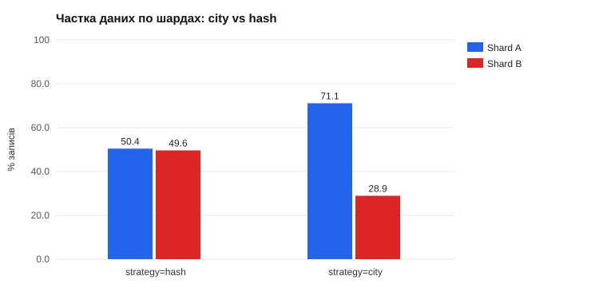

## Hot Shard: сплеск бронювань (демонстрація, п. 2.3)

`node scripts/sharding-demo.js hot -n 2000 -c 30 --cpus 0.25 --save`: 2000 бронювань, 90% — у готелях Kyiv, 30 паралельних клієнтів, CPU кожного шарду 0.25.

| Стратегія | Шард | Запитів | Частка запитів, % | Частка tuple-записів, % | p50, мс | p95, мс | p99, мс | Throughput, бронювань/с | CPU під час сплеску |
|---|---|---|---|---|---|---|---|---|---|
| city | shard-a | 1900 | 95.0 | 92.1 | 195.7 | 405.3 | 617.8 | 150.3 | database_shard_a 24.89%   database_shard_b 8.27% |
|  | shard-b | 100 | 5.0 | 7.9 | 18.1 | 29.9 | 91.7 |  |  |
| hash | shard-a | 978 | 48.9 | 48.0 | 58.3 | 176.1 | 211.2 | 301.4 | database_shard_a 18.45%   database_shard_b 25.62% |
|  | shard-b | 1022 | 51.1 | 52.0 | 101.0 | 297.3 | 399.1 |  |  |

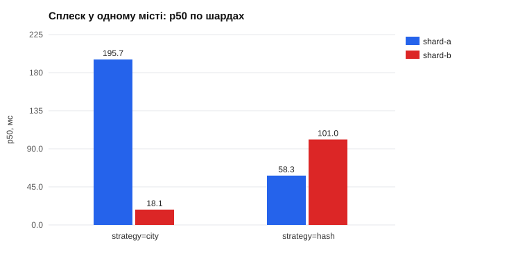

## Hot Shard: city vs hash (сценарій G, п. 2.3)

90% бронювань — у готелі одного міста (Kyiv). Однакові дані, 2 шарди, CPU кожного шарду обмежено; змінюється лише стратегія розміщення.

| Стратегія | Записи Shard A (%) | Записи Shard B (%) | CPU A avg / max, % | CPU B avg / max, % | Стабільний Throughput, RPS | Пік RPS | p95 / p99 на 100 VUs, мс | Насичення |
|---|---|---|---|---|---|---|---|---|
| city (наївна) | 94.9 | 5.1 | 21.5 / 27.1 | 3.4 / 11.4 | 162.2 | 295.2 | 698.6 / 1197.1 | 10 → 25 VUs (p95 ×4.3) |
| hash + virtual buckets | 43.7 | 56.3 | 15.4 / 28.0 | 20.1 / 27.9 | 164.9 | 453.4 | 502.3 / 731.3 | 10 → 25 VUs (p95 ×3.9) |

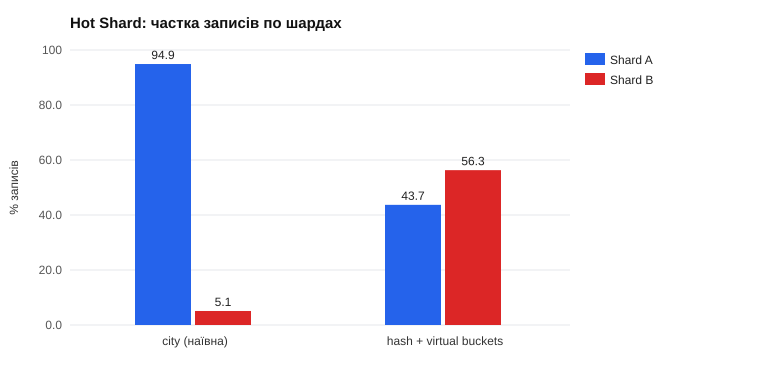

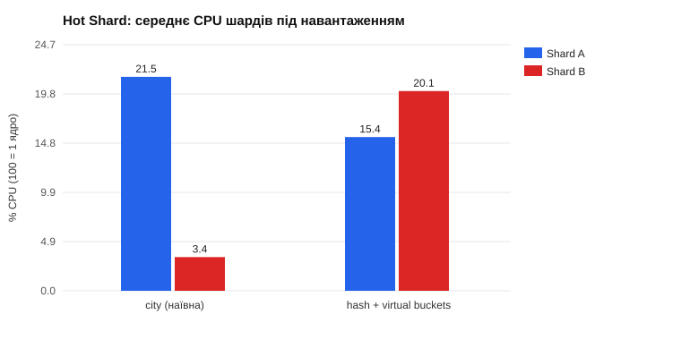

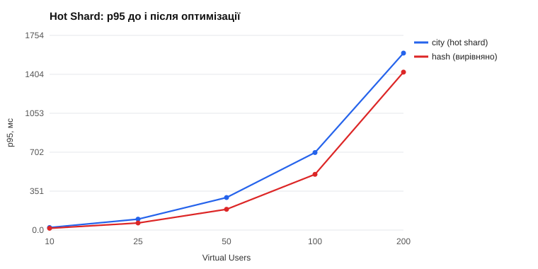

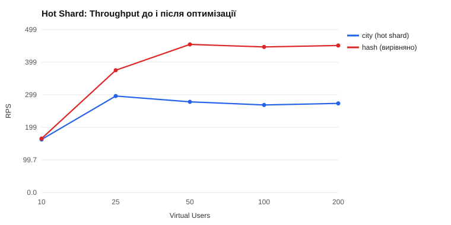

<details><summary>Повна таблиця: city</summary>

| VUs | Throughput (RPS) | Avg, мс | p50, мс | p95, мс | p99, мс | Error Rate, % | 5xx | 409 |
|---|---|---|---|---|---|---|---|---|
| 10 | 162.2 | 11.1 | 8.1 | 22.9 | 92.7 | 0.00 | 0 | 0 |
| 25 | 295.2 | 34.2 | 13.7 | 98.3 | 196.0 | 0.00 | 0 | 1 |
| 50 | 277.5 | 129.3 | 103.6 | 293.2 | 396.8 | 0.00 | 0 | 0 |
| 100 | 267.9 | 322.8 | 291.3 | 698.6 | 1197.1 | 0.02 | 4 | 4 |
| 200 | 272.7 | 683.6 | 600.8 | 1594.9 | 1893.0 | 0.00 | 0 | 6 |

</details>

<details><summary>Повна таблиця: hash</summary>

| VUs | Throughput (RPS) | Avg, мс | p50, мс | p95, мс | p99, мс | Error Rate, % | 5xx | 409 |
|---|---|---|---|---|---|---|---|---|
| 10 | 164.9 | 9.8 | 8.2 | 16.2 | 74.4 | 0.00 | 0 | 0 |
| 25 | 374.3 | 16.2 | 9.5 | 63.8 | 103.1 | 0.00 | 0 | 1 |
| 50 | 453.4 | 59.8 | 36.0 | 187.3 | 268.8 | 0.00 | 0 | 1 |
| 100 | 445.6 | 173.2 | 114.4 | 502.3 | 731.3 | 0.00 | 0 | 5 |
| 200 | 450.0 | 392.4 | 187.1 | 1423.6 | 2001.6 | 0.15 | 40 | 7 |

</details>

## Single Node vs Sharded: Shard-Local операції (сценарій E)

| Топологія | Стабільний Throughput, RPS | Пік RPS | p95 / p99 на 50 VUs, мс | p95 / p99 на 200 VUs, мс | Max Error Rate, % | Насичення | Commits/с A / B |
|---|---|---|---|---|---|---|---|
| Single Node (1 шард) | 118.9 | 283.2 | 302.8 / 501.7 | 1892.4 / 2412.2 | 0.00 | 10 → 25 VUs (p95 ×4.9) | 347.4 / 0.2 |
| Sharded (2 шарди) | 295.1 | 515.8 | 93.1 / 194.4 | 1206.5 / 1898.0 | 0.09 | 25 → 50 VUs (p95 ×6.8) | 303.2 / 249.4 |

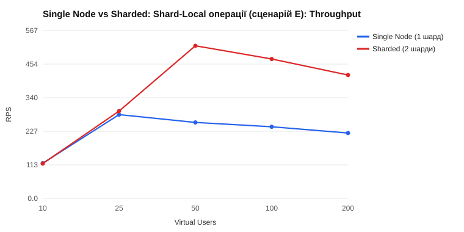

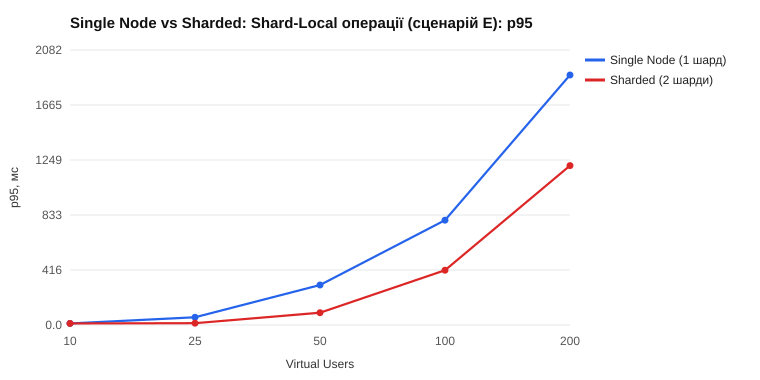

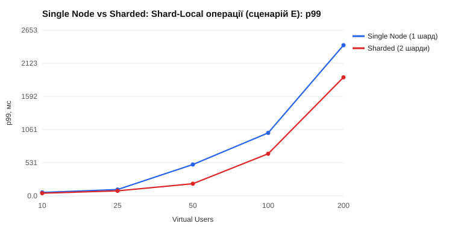

<details><summary>Повна таблиця: 1 шард</summary>

| VUs | Throughput (RPS) | Avg, мс | p50, мс | p95, мс | p99, мс | Error Rate, % | 5xx | 409 |
|---|---|---|---|---|---|---|---|---|
| 10 | 118.9 | 6.5 | 4.5 | 12.0 | 54.8 | 0.00 | 0 | 0 |
| 25 | 283.2 | 10.5 | 4.7 | 58.5 | 100.9 | 0.00 | 0 | 0 |
| 50 | 256.8 | 116.8 | 95.1 | 302.8 | 501.7 | 0.00 | 0 | 1 |
| 100 | 242.2 | 337.2 | 299.4 | 793.4 | 1008.1 | 0.00 | 0 | 0 |
| 200 | 221.0 | 823.4 | 714.1 | 1892.4 | 2412.2 | 0.00 | 0 | 1 |

</details>

<details><summary>Повна таблиця: 2 шарди</summary>

| VUs | Throughput (RPS) | Avg, мс | p50, мс | p95, мс | p99, мс | Error Rate, % | 5xx | 409 |
|---|---|---|---|---|---|---|---|---|
| 10 | 117.7 | 7.0 | 4.3 | 11.8 | 42.6 | 0.00 | 0 | 0 |
| 25 | 295.1 | 7.1 | 4.2 | 13.7 | 80.1 | 0.00 | 0 | 0 |
| 50 | 515.8 | 19.3 | 6.1 | 93.1 | 194.4 | 0.00 | 0 | 0 |
| 100 | 471.3 | 134.4 | 91.9 | 414.6 | 674.3 | 0.00 | 0 | 0 |
| 200 | 417.0 | 401.1 | 279.6 | 1206.5 | 1898.0 | 0.09 | 23 | 2 |

</details>

## Single Node vs Sharded: Cross-Shard Fan-out (сценарій F)

| Топологія | Стабільний Throughput, RPS | Пік RPS | p95 / p99 на 50 VUs, мс | p95 / p99 на 200 VUs, мс | Max Error Rate, % | Насичення | Commits/с A / B |
|---|---|---|---|---|---|---|---|
| Single Node (1 шард) | 90.6 | 189.7 | 388.8 / 498.5 | 2001.9 / 2321.0 | 0.00 | 10 → 25 VUs (p95 ×6.7) | 339.4 / 0.2 |
| Sharded (2 шарди) | 91.0 | 276.9 | 201.5 / 299.2 | 1312.2 / 1507.0 | 0.00 | 10 → 25 VUs (p95 ×4.8) | 452.5 / 453.3 |

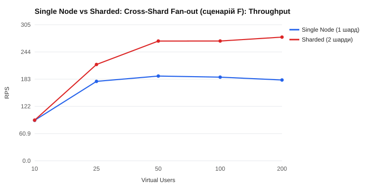

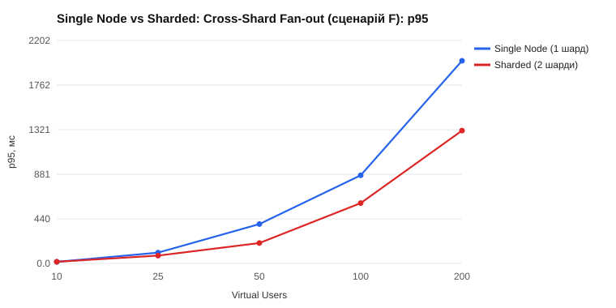

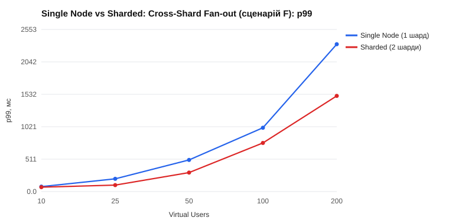

<details><summary>Повна таблиця: 1 шард</summary>

| VUs | Throughput (RPS) | Avg, мс | p50, мс | p95, мс | p99, мс | Error Rate, % | 5xx | 409 |
|---|---|---|---|---|---|---|---|---|
| 10 | 90.6 | 9.4 | 6.9 | 15.8 | 78.3 | 0.00 | 0 | 0 |
| 25 | 177.8 | 39.8 | 12.5 | 106.6 | 200.9 | 0.00 | 0 | 0 |
| 50 | 189.7 | 162.6 | 119.8 | 388.8 | 498.5 | 0.00 | 0 | 0 |
| 100 | 187.2 | 433.8 | 401.7 | 870.7 | 1005.1 | 0.00 | 0 | 0 |
| 200 | 180.8 | 1005.1 | 911.4 | 2001.9 | 2321.0 | 0.00 | 0 | 0 |

</details>

<details><summary>Повна таблиця: 2 шарди</summary>

| VUs | Throughput (RPS) | Avg, мс | p50, мс | p95, мс | p99, мс | Error Rate, % | 5xx | 409 |
|---|---|---|---|---|---|---|---|---|
| 10 | 91.0 | 8.8 | 7.1 | 16.2 | 69.5 | 0.00 | 0 | 0 |
| 25 | 215.6 | 14.8 | 7.6 | 77.3 | 102.0 | 0.00 | 0 | 0 |
| 50 | 268.0 | 85.7 | 83.1 | 201.5 | 299.2 | 0.00 | 0 | 0 |
| 100 | 268.1 | 271.6 | 222.2 | 595.9 | 765.9 | 0.00 | 0 | 0 |
| 200 | 276.9 | 622.4 | 528.0 | 1312.2 | 1507.0 | 0.00 | 0 | 0 |

</details>

## Shard-Local vs Cross-Shard: затримка одного запиту (п. 2.4)

Послідовні запити без конкуренції (200 на ендпоінт), `node scripts/sharding-demo.js latency`, Redis зупинено на час вимірювання (міряється PostgreSQL, а не кеш).

| Ендпоінт | Тип | Шардів у запиті | p50, мс | p95, мс | Avg, мс |
|---|---|---|---|---|---|
| `GET /rooms/:id` | Shard-Local | 1 | 4.0 | 4.8 | 4.0 |
| `GET /bookings/:id` | Shard-Local | 1 | 5.5 | 6.5 | 5.5 |
| `GET /sharding/analytics/hotels/:id` | Shard-Local | 1 | 3.2 | 4.2 | 4.4 |
| `GET /guests/:id/bookings` | Cross-Shard | 2 | 5.8 | 8.2 | 6.0 |
| `GET /rooms/search` | Cross-Shard | 2 | 14.3 | 30.4 | 16.8 |
| `GET /sharding/analytics/cities` | Cross-Shard | 2 | 4.7 | 5.5 | 4.7 |

## Модель решардингу (п. 2.5)

Симуляція на 100000 випадкових hotelId (`GET /sharding/resharding`, `src/sharding/resharding.ts`).

| Перехід | Схема | Переїжджає ключів, % | Теоретичний мінімум, % | Max / Avg навантаження після |
|---|---|---|---|---|
| 2 → 3 | modulo | 66.8 | 33.3 | 1.01 |
| 2 → 3 | virtual-buckets | 32.8 | 33.3 | 1.03 |
| 2 → 3 | consistent-hash | 33.5 | 33.3 | 1.09 |
| 2 → 4 | modulo | 50.3 | 50.0 | 1.01 |
| 2 → 4 | virtual-buckets | 50.2 | 50.0 | 1.01 |
| 2 → 4 | consistent-hash | 52.4 | 50.0 | 1.13 |
| 3 → 4 | modulo | 75.1 | 25.0 | 1.01 |
| 3 → 4 | virtual-buckets | 25.0 | 25.0 | 1.01 |
| 3 → 4 | consistent-hash | 28.3 | 25.0 | 1.13 |
| 4 → 5 | modulo | 80.2 | 20.0 | 1.00 |
| 4 → 5 | virtual-buckets | 18.8 | 20.0 | 1.03 |
| 4 → 5 | consistent-hash | 19.3 | 20.0 | 1.09 |

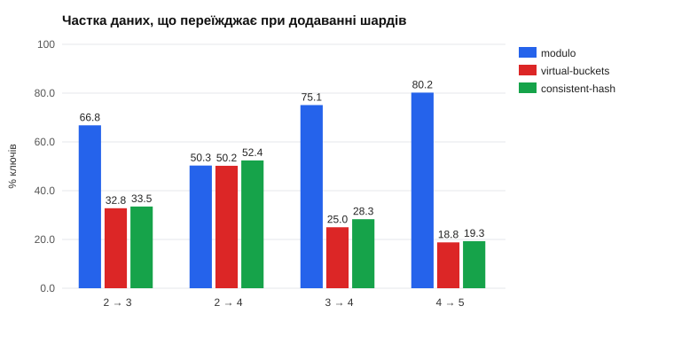

Рівномірність кільця Consistent Hashing залежно від кількості віртуальних вузлів (4 шарди):

| Віртуальних вузлів на шард | Max / Avg | Частки шардів, % |
|---|---|---|
| 1 | 1.80 | 22.2 / 45.1 / 27.8 / 4.9 |
| 16 | 1.52 | 37.9 / 19.6 / 15.6 / 26.9 |
| 128 | 1.13 | 23.0 / 24.5 / 24.3 / 28.3 |
| 512 | 1.04 | 23.6 / 25.4 / 25.1 / 25.9 |
