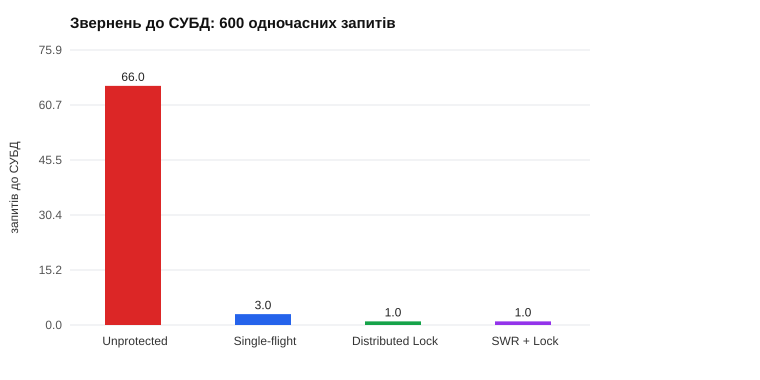
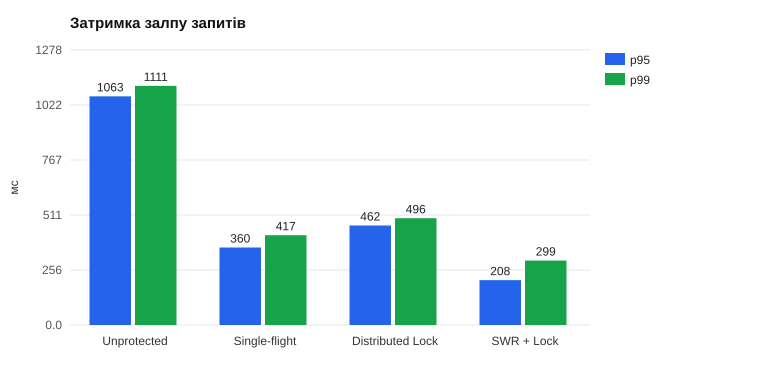
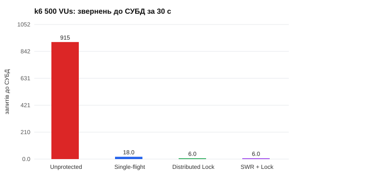
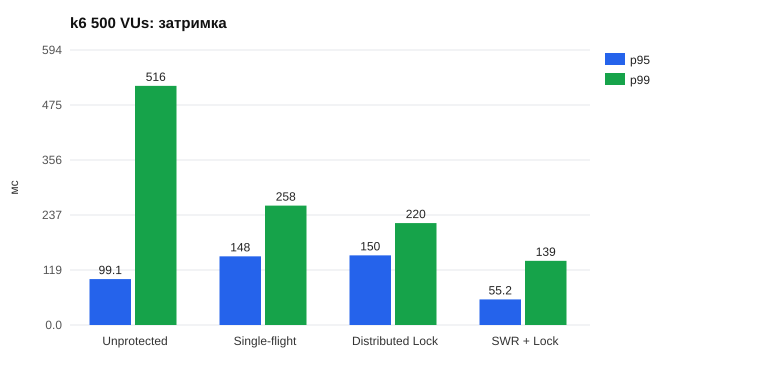
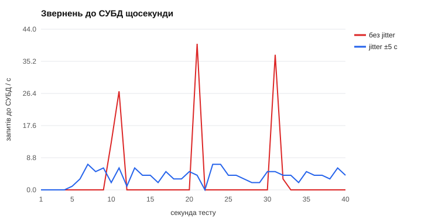
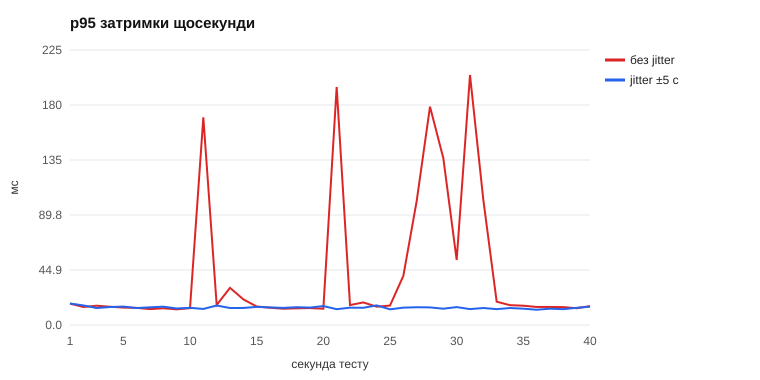
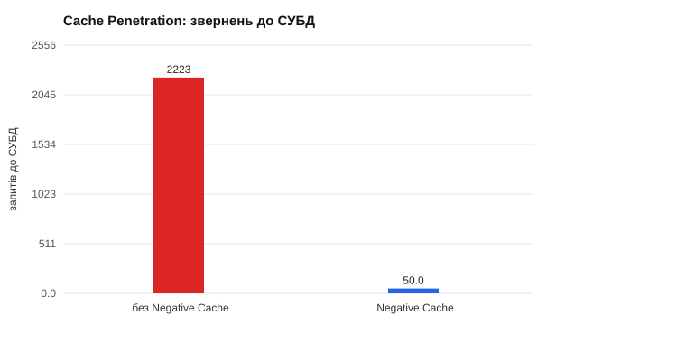

# Лаб. №8 — результати вимірювань

Згенеровано `node load-tests/report-resilience.js` з `load-tests/results-lab8/*.json`.

## 1. Cache Stampede: холодний ключ + 600 одночасних запитів (k6, per-vu-iterations)

| Режим | Запитів до СУБД (pg_stat_statements) | Лічильник API | Пік одночасних запитів у СУБД | Throughput (RPS) | p50, мс | p95, мс | p99, мс | Error Rate, % | X-Cache |
|---|---|---|---|---|---|---|---|---|---|
| Unprotected | **66** | 66 | 40 | 396.1 | 715.9 | 1062.6 | 1111.2 | 0.00 | HIT 534, MISS 66 |
| Single-flight | **3** | 3 | 3 | 676.7 | 177.8 | 360.1 | 417.3 | 0.00 | HIT 552, MISS 3, COALESCED 45 |
| Distributed Lock | **1** | 1 | 1 | 845.0 | 315.9 | 462.3 | 496.1 | 0.00 | HIT 179, MISS 1, COALESCED 142, LOCK-WAIT 278 |
| SWR + Lock | **1** | 1 | 1 | 1195.8 | 100.8 | 208.4 | 299.5 | 0.00 | HIT 236, STALE 364 |

## 2. Порівняльна матриця (п. 2.7): k6, 500 VUs × 30 с, ключ вигасає кожні 5 с

| Режим / Показник | Кількість запитів до СУБД | Throughput (RPS) | p95 Latency, мс | p99 Latency, мс | Error Rate, % | X-Cache |
|---|---|---|---|---|---|---|
| Unprotected | **915** | 928.9 | 99.1 | 516.2 | 0.00 | HIT 27368, MISS 915 |
| Single-flight | **18** | 916.7 | 148.2 | 257.7 | 0.00 | HIT 26587, MISS 18, COALESCED 1356 |
| Distributed Lock | **6** | 942.8 | 150.3 | 220.0 | 0.00 | HIT 26168, MISS 6, COALESCED 745, LOCK-WAIT 1581 |
| SWR + Lock | **6** | 963.0 | 55.2 | 138.5 | 0.00 | HIT 27604, MISS 1, COALESCED 165, LOCK-WAIT 334, STALE 1216 |

## 3. Cache Avalanche і TTL Jitter: 40 популярних ключів, TTL 10 с, 40 клієнтів, 40 с

| TTL | Звернень до СУБД, усього | Пік звернень за 1 с | p95 найгіршої секунди, мс | p99 за тест, мс |
|---|---|---|---|---|
| 10 с (без jitter) | 120 | **40** | **204.1** | 66.5 |
| 10 ± 5 с | 142 | **7** | **17.5** | 115.2 |

## 4. Cache Penetration: 3000 запитів до 50 неіснуючих готелів, 50 клієнтів

| Negative Caching | Запитів до СУБД | Відповідей з Negative Cache | Throughput (RPS) | p95, мс | p99, мс |
|---|---|---|---|---|---|
| вимкнено | **2223** | 0 | 192.2 | 505.6 | 784.6 |
| увімкнено | **50** | 2844 | 2238.8 | 21.7 | 252.0 |

