# Результати навантажувального тестування (Лаб. №5)

Згенеровано: 2026-10-24 16:02 (node load-tests/report.js)

## Baseline Environment Specification

Знято: 2026-10-24 18:35

| Параметр | Значення |
|---|---|
| Хост (CPU) | 12th Gen Intel(R) Core(TM) i7-12700H, 14 ядер / 20 потоків |
| Хост (RAM) | 31.6 ГБ |
| Docker Desktop | 20 CPU, 15.4 ГБ RAM |
| Ліміти контейнерів | load-tests/docker-compose.loadtest.yml: api 1 CPU / 512 МБ, db-primary 1 CPU / 1 ГБ, db-replica 1 CPU / 1 ГБ, redis 0.5 CPU / 256 МБ, nginx 1 CPU / 256 МБ |
| Backend | NestJS 10 (Node.js 24 у контейнері), 3 інстанси за Nginx (Round Robin), для Scaling — 1 інстанс |
| Пул з'єднань БД | connection_limit=10, pool_timeout=10 с на інстанс до кожного вузла БД |
| БД | PostgreSQL 16: Primary + Read Replica (асинхронна streaming replication); для Лаб. №5 і Single Primary читання йдуть на Primary |
| Кеш | Redis 7, maxmemory 128 МБ, allkeys-lru (для Caching — вимкнений / теплий) |
| Генератор навантаження | grafana/k6:1.0.0 в окремому контейнері, ліміт 2 CPU, мережа кластера (запити напряму до nginx) |
| Профіль | розігрів 30 с, ступені 10,25,50,100,200 VUs, перехід 10 с, утримання 60 с, пауза 0.1 с |
| Node.js на хості | v25.2.0 |

## Стан контейнерів

```
NAMES                 IMAGE                 STATUS
hotel_booking_api_2   backend-api-2         Up About an hour
hotel_booking_api_3   backend-api-3         Up About an hour
hotel_booking_api_1   backend-api-1         Up About an hour
hotel_booking_nginx   booking-hotel-nginx   Up 4 hours
database_replica      postgres:16           Up 4 hours (healthy)
database_primary      postgres:16           Up 4 hours (healthy)
hotel_booking_redis   redis:7-alpine        Up About a minute (healthy)
```


## Методика

- Інструмент: k6 (скрипти в `load-tests/`), генератор у окремому Docker-контейнері з лімітом CPU.
- Профіль: розігрів (warm-up) → ступені VUs; метрики беруться лише з фаз утримання кожного ступеня.
- Throughput = кількість запитів у фазі утримання / тривалість утримання.
- Error Rate = частка відповідей 5xx, 4xx (крім 409) і мережевих помилок. 409 — коректна бізнес-відмова (номер зайнятий).
- Точка насичення: перший ступінь, де Throughput росте менш ніж на 50% від приросту VUs, або p95 зростає більш ніж у 3 рази, або Error Rate > 1%.

## Scenario A — Read-Intensive — `repl-replica-a`

| VUs | Throughput (RPS) | Avg, мс | p50, мс | p95, мс | p99 (Tail), мс | Max, мс | Error Rate, % | 5xx | 409 | Cache HIT, % |
|---|---|---|---|---|---|---|---|---|---|---|
| 10 | 95.1 | 4.3 | 4.2 | 6.4 | 8.4 | 81.1 | 0.00 | 0 | 0 | 0.0 |
| 25 | 236.8 | 4.8 | 4.0 | 7.3 | 44.2 | 232.8 | 0.00 | 0 | 0 | 0.0 |
| 50 | 466.1 | 6.6 | 4.1 | 12.3 | 87.1 | 273.2 | 0.00 | 0 | 0 | 0.0 |
| 100 | 579.7 | 71.9 | 83.3 | 178.5 | 205.0 | 483.5 | 0.00 | 0 | 0 | 0.0 |
| 200 | 569.8 | 251.7 | 109.5 | 680.3 | 822.7 | 1081.1 | 0.00 | 0 | 0 | 0.0 |

**Точка насичення:** між 50 і 100 VUs (p95 ×14.5).
**Стабільна пропускна здатність:** 466.1 RPS при 50 VUs (p95 12.3 мс, p99 87.1 мс).
**Пікова пропускна здатність:** 579.7 RPS при 100 VUs.
**PostgreSQL за прогін:** 756 транзакцій (2/с), 0 відкатів.

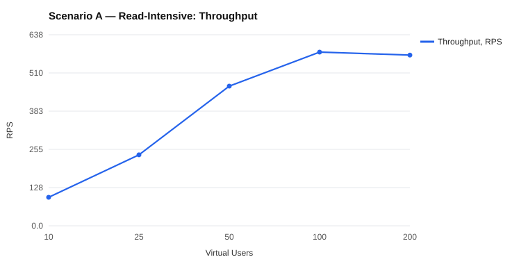

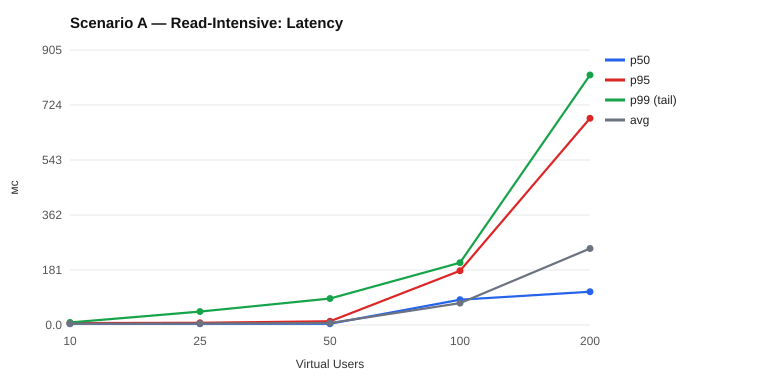

## Scenario D — Mixed Read/Write — `repl-replica-d`

| VUs | Throughput (RPS) | Avg, мс | p50, мс | p95, мс | p99 (Tail), мс | Max, мс | Error Rate, % | 5xx | 409 | Cache HIT, % |
|---|---|---|---|---|---|---|---|---|---|---|
| 10 | 107.6 | 4.9 | 4.5 | 8.4 | 11.8 | 76.7 | 0.00 | 0 | 0 | 0.0 |
| 25 | 266.9 | 6.0 | 4.4 | 9.5 | 68.0 | 316.4 | 0.00 | 0 | 0 | 0.0 |
| 50 | 518.8 | 8.5 | 4.6 | 20.9 | 93.4 | 409.7 | 0.01 | 3 | 0 | 0.0 |
| 100 | 682.5 | 59.1 | 45.3 | 175.7 | 274.0 | 590.7 | 0.02 | 7 | 0 | 0.0 |
| 200 | 681.5 | 206.3 | 92.3 | 701.9 | 881.5 | 1311.2 | 0.01 | 6 | 2 | 0.0 |

**Точка насичення:** між 50 і 100 VUs (p95 ×8.4).
**Стабільна пропускна здатність:** 518.8 RPS при 50 VUs (p95 20.9 мс, p99 93.4 мс).
**Пікова пропускна здатність:** 682.5 RPS при 100 VUs.
**PostgreSQL за прогін:** 145889 транзакцій (377.6/с), 31 відкатів.

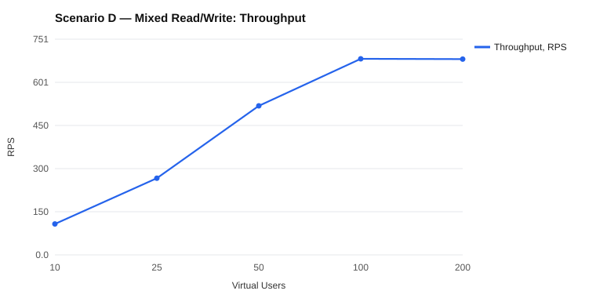

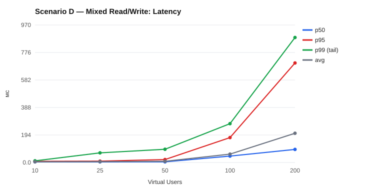

## Scenario A — Read-Intensive — `repl-single-a`

| VUs | Throughput (RPS) | Avg, мс | p50, мс | p95, мс | p99 (Tail), мс | Max, мс | Error Rate, % | 5xx | 409 | Cache HIT, % |
|---|---|---|---|---|---|---|---|---|---|---|
| 10 | 94.7 | 4.7 | 4.5 | 6.6 | 10.6 | 73.4 | 0.00 | 0 | 0 | 0.0 |
| 25 | 234.4 | 5.8 | 4.7 | 9.0 | 44.5 | 326.3 | 0.00 | 0 | 0 | 0.0 |
| 50 | 456.6 | 8.8 | 4.6 | 25.2 | 96.6 | 297.8 | 0.00 | 0 | 0 | 0.0 |
| 100 | 575.8 | 73.0 | 83.4 | 182.2 | 280.3 | 498.0 | 0.00 | 0 | 0 | 0.0 |
| 200 | 577.1 | 245.7 | 96.7 | 686.9 | 864.8 | 994.7 | 0.00 | 0 | 0 | 0.0 |

**Точка насичення:** між 50 і 100 VUs (p95 ×7.2).
**Стабільна пропускна здатність:** 456.6 RPS при 50 VUs (p95 25.2 мс, p99 96.6 мс).
**Пікова пропускна здатність:** 577.1 RPS при 200 VUs.
**PostgreSQL за прогін:** 275986 транзакцій (714.2/с), 0 відкатів.

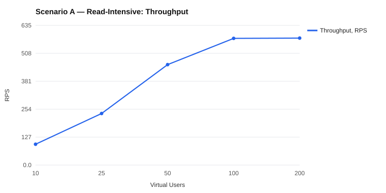

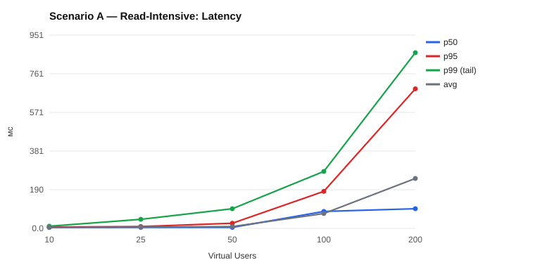

## Scenario D — Mixed Read/Write — `repl-single-d`

| VUs | Throughput (RPS) | Avg, мс | p50, мс | p95, мс | p99 (Tail), мс | Max, мс | Error Rate, % | 5xx | 409 | Cache HIT, % |
|---|---|---|---|---|---|---|---|---|---|---|
| 10 | 102.4 | 9.6 | 4.5 | 8.6 | 38.8 | 2806.3 | 0.00 | 0 | 0 | 0.0 |
| 25 | 264.1 | 7.5 | 4.5 | 11.4 | 94.0 | 306.8 | 0.01 | 2 | 0 | 0.0 |
| 50 | 364.7 | 49.5 | 17.0 | 109.5 | 206.9 | 595.2 | 0.02 | 5 | 1 | 0.0 |
| 100 | 361.9 | 188.9 | 182.5 | 479.0 | 603.5 | 1095.7 | 0.02 | 4 | 0 | 0.0 |
| 200 | 363.1 | 464.3 | 306.7 | 1394.5 | 1796.6 | 2492.1 | 0.02 | 5 | 2 | 0.0 |

**Точка насичення:** між 25 і 50 VUs (p95 ×9.6).
**Стабільна пропускна здатність:** 264.1 RPS при 25 VUs (p95 11.4 мс, p99 94.0 мс).
**Пікова пропускна здатність:** 364.7 RPS при 50 VUs.
**PostgreSQL за прогін:** 249831 транзакцій (646.6/с), 39 відкатів.

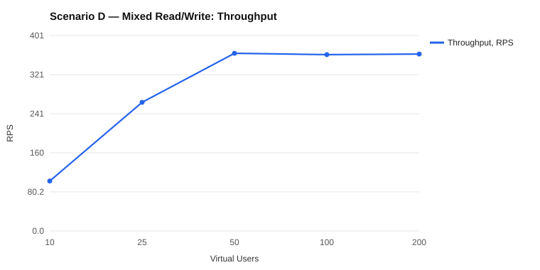

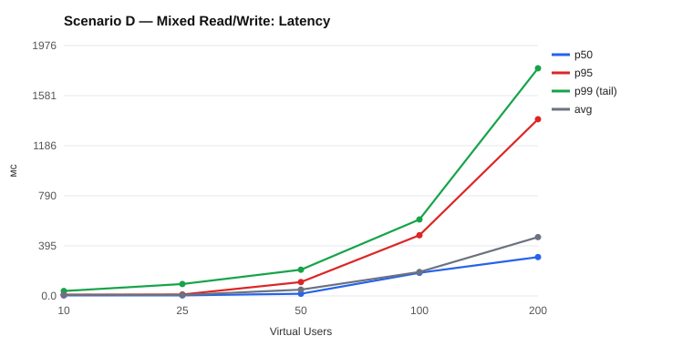

## Read Scaling Impact (Лаб. №6): Single Primary vs Primary + Replica — Scenario A — Read-Intensive

| VUs | RPS Single | RPS P+R | p95 Single, мс | p95 P+R, мс | p99 Single, мс | p99 P+R, мс | Error Single, % | Error P+R, % |
|---|---|---|---|---|---|---|---|---|
| 10 | 94.7 | 95.1 | 6.6 | 6.4 | 10.6 | 8.4 | 0.00 | 0.00 |
| 25 | 234.4 | 236.8 | 9.0 | 7.3 | 44.5 | 44.2 | 0.00 | 0.00 |
| 50 | 456.6 | 466.1 | 25.2 | 12.3 | 96.6 | 87.1 | 0.00 | 0.00 |
| 100 | 575.8 | 579.7 | 182.2 | 178.5 | 280.3 | 205.0 | 0.00 | 0.00 |
| 200 | 577.1 | 569.8 | 686.9 | 680.3 | 864.8 | 822.7 | 0.00 | 0.00 |

**Пікова пропускна здатність:** Single Primary — 577.1 RPS, Primary + Replica — 579.7 RPS (×1.00).
**Стабільна пропускна здатність:** Single Primary — 456.6 RPS при 50 VUs, Primary + Replica — 466.1 RPS при 50 VUs.
**Точка насичення:** Single Primary — 50–100 VUs (p95 ×7.2); Primary + Replica — 50–100 VUs (p95 ×14.5).

**Розподіл транзакцій між вузлами СУБД:**

| Топологія | Primary, транзакцій/с | Replica, транзакцій/с | Частка на Replica, % |
|---|---|---|---|
| Single Primary | 714.2 | 0 | 0.0 |
| Primary + Replica | 2 | 713.3 | 99.7 |

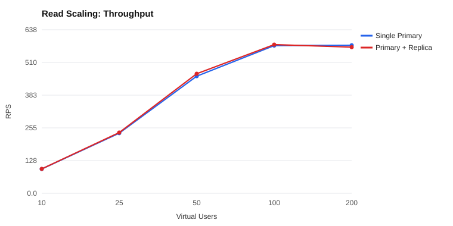

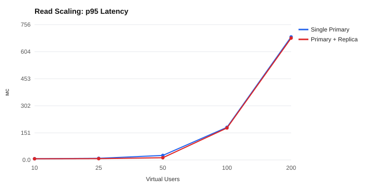

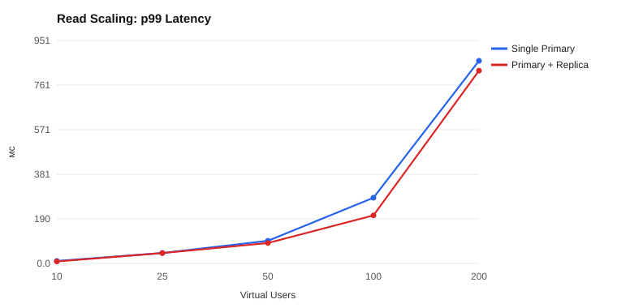

## Read Scaling Impact (Лаб. №6): Single Primary vs Primary + Replica — Scenario D — Mixed Read/Write

| VUs | RPS Single | RPS P+R | p95 Single, мс | p95 P+R, мс | p99 Single, мс | p99 P+R, мс | Error Single, % | Error P+R, % |
|---|---|---|---|---|---|---|---|---|
| 10 | 102.4 | 107.6 | 8.6 | 8.4 | 38.8 | 11.8 | 0.00 | 0.00 |
| 25 | 264.1 | 266.9 | 11.4 | 9.5 | 94.0 | 68.0 | 0.01 | 0.00 |
| 50 | 364.7 | 518.8 | 109.5 | 20.9 | 206.9 | 93.4 | 0.02 | 0.01 |
| 100 | 361.9 | 682.5 | 479.0 | 175.7 | 603.5 | 274.0 | 0.02 | 0.02 |
| 200 | 363.1 | 681.5 | 1394.5 | 701.9 | 1796.6 | 881.5 | 0.02 | 0.01 |

**Пікова пропускна здатність:** Single Primary — 364.7 RPS, Primary + Replica — 682.5 RPS (×1.87).
**Стабільна пропускна здатність:** Single Primary — 264.1 RPS при 25 VUs, Primary + Replica — 518.8 RPS при 50 VUs.
**Точка насичення:** Single Primary — 25–50 VUs (p95 ×9.6); Primary + Replica — 50–100 VUs (p95 ×8.4).

**Розподіл транзакцій між вузлами СУБД:**

| Топологія | Primary, транзакцій/с | Replica, транзакцій/с | Частка на Replica, % |
|---|---|---|---|
| Single Primary | 646.6 | 0 | 0.0 |
| Primary + Replica | 377.6 | 612.8 | 61.9 |

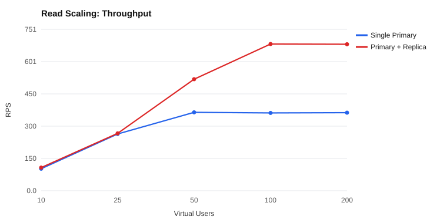

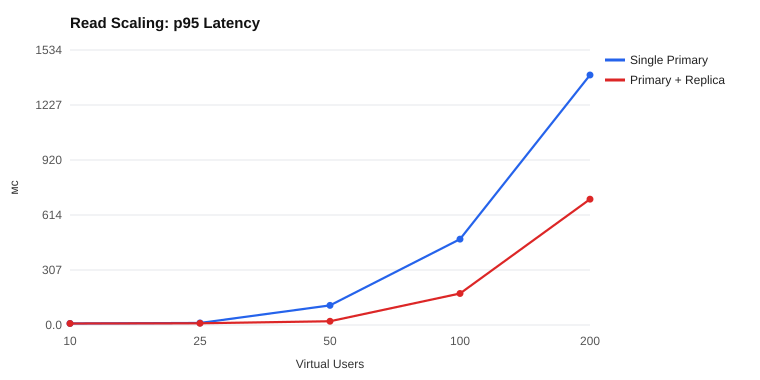

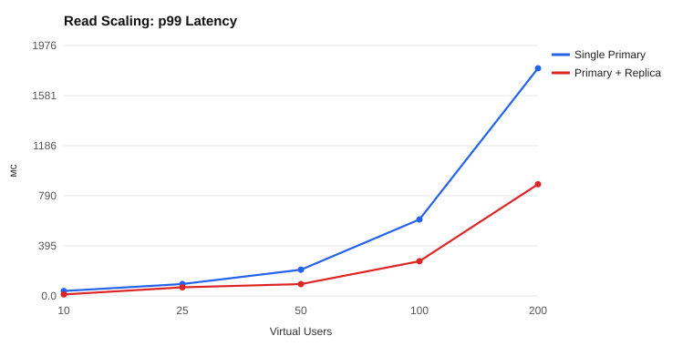
